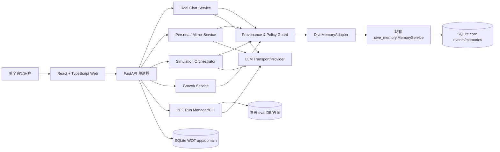

# 《我们曾聊过》系统与详细设计文档（SDD）

> SDD v1.0｜2026-10-30｜状态：**目标架构与接口契约；不代表代码已实现**
>
> 必读：`00_RESEARCH_AND_DECISIONS.md` 引擎规则 ER-01～ER-28；`01_PRD.md` 功能 FR-001～FR-018。本文件给出可实现的边界、数据模型、状态机、API、算法、界面与测试。

## 1. 架构决策记录（ADR）

| ADR | 结论 | 理由 | 不采用的方案 |
|---|---|---|---|
| A-001 | 新建独立产品仓库，旧 D.I.V.E 仓库只读保留 | 项目背景/前后端彻底更换但长期记忆投入仍可复用 | 在原仓库直接删除大量历史代码与证据 |
| A-002 | 首版为本地单体（FastAPI/Python+SQLite+React/TS） | 小团队、无公网账户、便于原有 Python 核心集成 | 微服务、消息队列、K8s、强制 PG |
| A-003 | 通过 `DiveMemoryAdapter` 依赖/固定版本接入旧 core | 复用事件/时间/删除/检索且避免原业务耦合 | 假定旧应用 `MemoryApplication` 是通用 Persona 层 |
| A-004 | 真实事件与模拟事件强隔离；存储层权限校验 | prompt 无法保证不污染、不泄露 | 使用同一个聊天记录表、靠 system prompt 提醒 |
| A-005 | Perceived / Observed / Chosen 三轨分开 | 用户选择目标不改写历史；推断不冒充自我陈述 | 一个不断被 AI 修改的 `persona.json` |
| A-006 | Persona Snapshot 内容寻址、不可变 | 可追溯、可复现实验、删除传播和会话一致性 | 每轮自动覆盖一个 SKILL.md |
| A-007 | “Skill”采用安全数据包 + 独立 Agent runtime | 兼容 `SKILL.md` 但防任意执行 | 直接安装运行用户导入的 Skill/scripts |
| A-008 | 两个 Agent 各自上下文/模型调用 + 服务端编排 | 避免一次调用包办两个人，能测信息泄露 | 一次 prompt 生成完整对话并声称独立 Agent |
| A-009 | PFE 基准与真实答案存于独立评测边界 | 防数据泄漏与测试集污染 | 在线模型可查阅 benchmark 参考答案 |
| A-010 | Growth 只能由用户确认目标/行动 | 自主性和避免操控 | Agent 自动设定理想人格和现实任务 |

## 2. 系统容器与依赖边界



**进程限制：** SQLite 首版一进程；生产开发环境禁用多个 uvicorn workers。真实用户/外部第三方的身份鉴权是服务器数据层责任，不允许通过模型 prompt 授权。

### 2.1 建议代码布局（新仓库目标状态）

```text
we-once-talked/
├── docs/                      # 本文档及 ADR / 数据协议
├── backend/
│   ├── pyproject.toml
│   └── wot/
│       ├── main.py            # FastAPI composition root
│       ├── config.py
│       ├── api/               # routes, errors, pagination, auth
│       ├── domain/            # enums, entity schemas, state transitions
│       ├── storage/           # WOT sqlite migrations and UoW
│       ├── dive_adapter/      # 严格只调用已经核实的 dive_memory 接口
│       ├── provenance/        # source classification, grants, lineage
│       ├── personas/          # extraction, consolidation, compiler, mirror
│       ├── skills/            # safe parser, manifest validator, registry
│       ├── simulation/        # isolated agents, orchestrator, budgets
│       ├── evaluation/        # dataset freeze, baselines, paired metrics
│       ├── growth/            # user approved goal/action/checkin
│       └── model/             # provider protocol, transport, usage
├── frontend/
│   ├── src/
│   │   ├── pages/             # Welcome, RealChat, Mirror, Studio, Sim, Settings
│   │   ├── components/        # EvidenceCard, PersonaCompare, Transcript, Feedback
│   │   ├── features/          # typed API clients, hooks, state
│   │   ├── styles/            # responsive design tokens
│   │   └── app/
│   └── package.json
├── tests/
│   ├── unit/
│   ├── integration/
│   ├── contract/
│   ├── adversarial/
│   └── e2e/
├── eval/
│   ├── protocols/             # 研究方案，版本化
│   ├── public_synthetic/      # 可提交仓库的合成数据
│   └── private/               # .gitignore，真实保留集和真实答案
├── scripts/                   # 本地启动/备份/导出/验证
└── .github/workflows/         # Python + TS CI（无真实 key）
```

核心依赖初版从旧仓库 checkout 的只读工作树安装（或从公开 Git 仓库固定 commit 安装），**不能复制原 `static/`、`application/workspace`、Oracle 和 eval 报告当成新业务层**。后续可将通用核心逐步抽离，但迁移前须保持原测试行为不回退。

## 3. 核心数据安全分区

### 3.1 来源类型（不可省）

```python
class SourceOrigin(str, Enum):
    REAL_USER_MESSAGE = 'REAL_USER_MESSAGE'          # 用户本次真实发言
    USER_SELF_REPORT = 'USER_SELF_REPORT'            # 用户自述真实发生过的行动
    USER_CORRECTION = 'USER_CORRECTION'              # 用户对个人信息的明确更正
    USER_CHOSEN_DIRECTIVE = 'USER_CHOSEN_DIRECTIVE'  # 用户确认理想目标
    AUTHORIZED_IMPORT = 'AUTHORIZED_IMPORT'          # 有许可的外部真实证据
    EXTERNAL_SKILL_DATA = 'EXTERNAL_SKILL_DATA'      # 外部人物资料
    MODEL_INFERENCE = 'MODEL_INFERENCE'              # LLM 证据解释，非原始事实
    SIMULATED_DIALOGUE = 'SIMULATED_DIALOGUE'        # 数字人格虚拟对话
    SIMULATION_FEEDBACK = 'SIMULATION_FEEDBACK'      # 真人评价模拟句子
    EVALUATION_PRIVATE = 'EVALUATION_PRIVATE'        # 独立评测语料/答案
```

对外暴露的 `EvidenceState` 可以沿用 D.I.V.E 的 `FACT/OBSERVATION/INFERENCE`，但必须另建 `source_origin` 和 `claim_kind`：两者分别代表**材料从哪里来**和**材料在说什么**。例如用户说“我想更果断”是用户真实发言，但内容是 `ASPIRATION`，不是“用户已经果断”的 FACT。

### 3.2 确定性访问矩阵（默认拒绝）

| 数据类别 | 真人真聊记忆写入 | Observed 推断 | Chosen 编译 | 模拟 Agent 检索 | PFE 开发/生产模型 |
|---|---:|---:|---:|---:|---:|
| 已授权真实用户发言 | 按设置 | 可 | 用户允许时可 | 按目的与 scope 精选 | 仅训练划分可 |
| 用户自报现实行动 | 允许、标记自报 | 可（分级） | 可作为背景 | 需要主动允许 | 仅训练划分可 |
| 用户明确 Chosen 目标 | 作为目标非事实 | **不可当既有事实** | 可 | 仅 Chosen agent 可 | PAA/目标测试可 |
| 外部 Skill 内容 | 仅第三方资料域 | **禁止** | 禁止 | 第三方 agent 授权使用 | 禁止进入用户画像 |
| 模拟对话原文 | **禁止** | **禁止** | **禁止自动使用** | 仅当轮公开上下文 | 不得作为真人标准答案 |
| 真人对模拟的反馈 | 只进入反馈域 | 仅明示新事实并再次确认可 | 目标更改需确认 | 后续已批准版本可 | 不可污染冻结保留集 |
| PFE 独立参考答案 | **禁止** | **禁止** | **禁止** | **禁止** | 只有隔离 Judge 进程可 |

适配器层 `admit_real_evidence()` 和 `store_simulation_turn()` 必须是**不同接口/不同表/不同访问主体**。即使异常调用用户输入 `source_origin=REAL_USER_MESSAGE`，服务端仍要通过真实聊天会话的**可信请求上下文**确定来源，不允许客户端直接声明任意可信来源。

### 3.3 数据隔离与 namespace

- D.I.V.E namespace 示例：`user/{uid}/real`、`user/{uid}/self_reports`、`user/{uid}/corrections`；外部 Skill 使用单独 `skill/{sid}/source`。
- WOT App DB 按 `owner_id`、`subject_id`、`visibility_scope` 实施查询过滤。即便初版单用户也保留明确授权字段，避免未来返工。
- 评测私有答案只存 `eval/private` 的独立 SQLite 或加密容器，生产应用进程不挂载、不引用。
- Prompt 组装前以服务端 Policy Guard 按 `owner+subject+purpose+as_of+export_grant` 校验；模型返回不能扩权。
- 每项来源维护 `dependency_edges`，供撤销与删除传播。硬删除策略优先沿用 D.I.V.E 已有 tombstone 机制，审计不保存已删敏感正文。

## 4. 存储模型（初版逻辑 Schema）

> 以下是新产品需要的**逻辑实体与字段契约**，并非已存在的表或强制要求照抄 SQL。迁移时先检查现有 D.I.V.E 表/事务边界，避免重复实现通用版本与事件系统。

```text
AccountLocal(id, created_at, privacy_policy_version)
RealConversation(id, owner_id, external_skill_id, retention_policy, created_at)
RealMessage(id, conversation_id, speaker:{USER|AGENT}, content_ref, event_id?, created_at)
EvidenceLink(id, owner_id, dive_namespace, dive_memory_id, source_origin, claim_kind,
             subject_id, context_domain, occurred_at, observed_at, consent_scope,
             visibility_scope, status, content_hash)
PersonaTrait(id, owner_id, track:{PERCEIVED|OBSERVED|CHOSEN}, trait_key, domain,
             relationship, proposition, polarity, status, supports[], counters[],
             as_of, valid_from, valid_to, extraction_policy_version)
PersonaVersion(id, owner_id, track, version, evidence_snapshot_hash,
               compiler_version, model_config_hash, created_at, state, invalidated_reason)
ChosenDirective(id, owner_id, version_id, objective, behavior_if, behavior_then,
                limits, domain, state, user_approval_event, created_at)
SkillManifest(id, owner_id?, display_name, category:{CURATED|CONSENTED|PRIVATE},
              source_uri, version, permission_record, prompt_data_hash, status)
SimulationSession(id, owner_id, persona_version_id, external_skill_version_id,
                  topic, disclosed_as_ai, state, max_turns, max_tokens, budget,
                  created_at, stopped_at)
SimulationTurn(id, session_id, speaker_agent_id, turn_index, content_ref,
               evidence_refs[], is_generated=true, usage, status)
SimulationFeedback(id, turn_id, owner_id, verdict, comment, intent_scope,
                   review_state, created_at)
GrowthGoal(id, owner_id, chosen_directive_id, title, approval_event, state)
GrowthAction(id, goal_id, trigger, planned_response, due_hint?, state, user_approved_at)
GrowthCheckin(id, action_id, owner_id, outcome_self_report, notes, created_at)
EvalProtocol(id, schema_version, dataset_manifest_hash, metrics, baselines,
             frozen_before_run, locked_at)
EvalRun(id, protocol_id, persona_version_id, model_hash, test_dataset_hash,
        completion_status, seed, paired_result_ref, report_ref, cost, created_at)
DependencyEdge(parent_type, parent_id, child_type, child_id, edge_kind)
PrivacyGrant(id, owner_id, grantee_role, purpose, field_scope, status, expires_at)
AuditEvent(id, actor_type, operation, resource_type, resource_id, status,
           timestamp, content_hash_or_redacted_detail)
```

**索引与约束：** `RealMessage(conversation_id, created_at)`；`PersonaTrait(owner_id,track,domain,status)`；`EvidenceLink(dive_namespace,dive_memory_id)` unique；`PersonaVersion(owner_id,track,version)` unique；`SimulationTurn(session_id,turn_index)` unique；所有 FK 打开、外键级联/软删除须符合删除依赖规则；审计日志不放原文/API key。

**Snapshot 特别规则：** snapshot 是编译后的结构化快照及有效 evidence references，不是独立永久保存的全部私人原文。删除底层引用触发 invalidation，绝不“仍可从快照反向读到已删除内容”。

## 5. 核心 Engine 的可执行算法

### 5.1 Real Evidence Ingest（唯一真人写入口）

```text
function admit_real_evidence(auth_ctx, conversation_id, message_id, raw_text):
    assert auth_ctx.actor == LOCAL_HUMAN_USER
    assert real_conversation.owner_id == auth_ctx.owner_id
    assert message_id belongs to a USER turn, not AGENT or SIMULATION
    assert retention/consent permits writing
    source_origin := REAL_USER_MESSAGE  # server decides; never trust client value
    stable_key := hash(owner_id, conversation_id, message_id, source_origin)
    with unit_of_work:
        call verified DiveMemoryAdapter.ingest(..., source_type=..., idempotency_key=stable_key)
        create EvidenceLink with source+purpose+time+hash
        queue reviewable persona extraction candidate (not auto-publish)
    return admitted id or deterministic duplicate
```

如果现有 D.I.V.E `ingest` 和 App DB 无法共享一个数据库事务，必须使用**持久 Outbox/Saga 补偿**：先记录待处理 claim、可靠消费、关联事件、异常恢复；不得宣称伪原子性，也不得让 UI 在半写入时显示“已完成”。

### 5.2 Perceived/Observed/Chosen 更新规则

**Perceived**：只有用户自我陈述/明确更正作为主要来源；“我希望…”要进入 Chosen 候选，不能自动标成现状。可存在多个时间点、条件和互相冲突的表述。

**Observed**：

```text
for each incoming validated real evidence:
    extract candidate with citations and context
    validate citation ownership, source trust, time, consent
    if no direct support => REJECT or NEEDS_REVIEW
    gather independent supports and counters in the same domain and relationship
    if fewer than policy.min_independent_evidence or low diversity:
        status := HYPOTHESIS or INSUFFICIENT
    else if meaningful conflict without explicit resolution:
        status := CONFLICTED
    else:
        status := SUPPORTED  # supported model claim, NOT verified ground truth
    stage new projection; preserve old and newer validity windows
```

初版 `min_independent_evidence` 为研究配置项而非固定人格科学阈值；必须避免同一次对话重复表述被计为多个独立证据。界面展示支持/反例及采样范围；模型提供的 `confidence` 不展示为概率，除非经过校准。矛盾证据可显示“情境差异”的假设，但不能伪造原因。

**Chosen**：

```text
propose_goal(user_text, domain, contraindications) -> PROPOSED
user_review(proposal) -> USER_APPROVED (explicit click, event)
compile_chosen(persona_base_version, approved_directive_ids) -> immutable snapshot
new_feedback -> new proposal, NOT silent mutation
user_reject/pause -> new event; old snapshot RETIRED/visible for review
```

### 5.3 Persona Compiler

输入：`track, topic, audience, as_of, persona_version_id, max_tokens, visibility_grant`。
输出：结构化 `PersonaRuntimeContext`：

```json
{
  "persona_version_id": "pv_001",
  "track": "CHOSEN",
  "scope": "career_decisions",
  "self_claims": [{"text":"希望更及时做重大决定","kind":"ASPIRATION","evidence_refs":["ev_12"]}],
  "supported_patterns": [{"text":"面对高风险决定会先核查关键事实","status":"SUPPORTED","evidence_refs":["ev_08","ev_09"]}],
  "allowed_goal_constraints": ["不隐瞒关键风险", "不为了果断而仓促决定"],
  "uncertainties": ["其他生活领域证据不足"],
  "retrieved_evidence_refs": ["ev_08","ev_09","ev_12"],
  "disclosure_policy": "do_not_disclose_private_memory"
}
```

以上字段值均为演示合成数据。Compiler 排除 `SIMULATED_DIALOGUE`、`EVALUATION_PRIVATE`、已删除/未授权来源；与 retrieval 之间用窄接口而非全库 dump。每个 prompt 输出的 `source_refs` 必须是服务端实际提供过的引用；LLM 编造 ref 视为错误。

### 5.4 Skill Package 规范（WOT 安全子集）

- 接收普通 `.md/.json` 和包内 `SKILL.md`，解析 YAML frontmatter 的 `name/description/version/license/author` 等**数据字段**；读取有限参考文本。
- 禁止执行 `scripts`、安装依赖、自动加载工具、处理外部 URL、读取任意本地文件；`allowed-tools`/`run`/嵌入命令一律不授予权限。
- 要求导入者为真实朋友提供 consent grant，或选择明确为解释性公共角色/虚构角色；声明非官方、非本人。
- `SkillManifest` 包含来源/许可/版本/允许用途/共享范围/禁用状态；不信任模型输出的版权和身份保证。
- 对来源文本做大小限制、路径规范化、扩展名白名单和沙箱读取；转义 HTML；即便是 YAML 中的系统指令，也只作**最低优先级角色资料**，不能覆盖运行时隐私策略。

### 5.5 Simulation Orchestrator（隔离的双 Agent）

```text
start_simulation(owner, topic, persona_version, skill_version, turn_cap=6):
    assert persona_version active and user has chosen experimental/verified mode
    assert skill permitted and user grant allows topic-specific disclosed context
    persist session(mode_label, frozen_versions, budget, state=CREATED)
    public_transcript := [user_provided_topic]
    for turn_no in range(turn_cap):
        agent = choose_next_agent(turn_no)
        private_context = compiler.compile(agent, topic, audience,
                                           memory_budget, purpose='SIMULATION')
        candidate = llm.generate(system_safety, persona_data,
                                 public_transcript, private_context)
        if stopped, budget exceeded, missing permission: stop before next call
        validate output limits, safe context, no hidden memory refs in public text
        persist SIMULATED_DIALOGUE turn only; append its public text to transcript
    state = COMPLETED or PAUSED/FAILED/CANCELLED
```

- 两个 agent 独立上下文、检索工具对象、身份与预算；不得互读私有系统消息、记忆列表和评分秘密。
- `public_transcript` 仅含用户选定话题和实际公开模拟话语；任何“无来源的推测”应表达不确定而非陈述为真实人物经历。
- 每轮生成可见答案与**私有审计引用**分开；UI 的“为什么会这样说”从已授权的证据引用读取，不泄露被隐藏的原始秘密。
- 用户暂停反馈，默认不中途改变当前冻结的 PersonaVersion；接受修改后由用户选择“新版本重开模拟”，防止回放不可复现。
- 同一 session 明确 `provider/model/temperature/version/timeout/max_tokens/price/cost_policy`；前端可看到 estimated/actual usage；异常不自动悄悄重试付费模型调用。

### 5.6 Feedback 的四种类型

```text
SIM_STYLE_CORRECTION       # 这不像我说话（只用于风格修正候选）
SIM_VALUE_DISAGREEMENT     # 这不是我认可的立场（可提出 Perceived/Chosen 候选）
NEW_REAL_USER_STATEMENT    # 我明确告诉系统：现实中的我确实这么想（需再次明确确认）
CHOSEN_GOAL_AMENDMENT      # 我希望以后这样表达（需用户确认并产生新版本）
```

接受反馈并不自动更新旧模拟 transcript 或未经批准的人格。User correction 的来源始终指向真实人类操作（不是“AI 承认自己像用户”）。

### 5.7 Growth Engine（P1）

输入来自 `USER_APPROVED` 的 ChosenDirective。输出为可选的行动建议：`trigger (if) + action (then) + domain + feasibility_notes + exit_rule`。用户再批准 `GrowthAction`，完成后只写 `USER_SELF_REPORT`，可选择不存细节。

- 行动需足够微小、具体、可撤回；默认不强制 deadline。
- 用户可以拒绝/暂停行动并重新定义方向；不将未执行视作“失败人格”。
- 重度心理困扰及高风险重大决策不得由分身强制引导；产品不提供心理治疗或专业建议。
- 对多次行动的观察应明确区分“行动日志”“自报结果”“系统推测因果”，不得自动宣称“已经成长”。

## 6. PFE-Bench：独立评价设计

### 6.1 四组对照（固定同一个生成底模）

`B0: no_personal_data`；`B1: static_bio`；`B2: summary_rag`；`D: dive_structured_persona`。

从同一批真人历史数据构造不同输入表示；公开比较各路 token budget，不允许 D 分到更长预算后宣称只因为记忆策略更好。评测运行冻结 LLM 版本、温度、prompt version、persona version、as_of、测试集 hash 与分组规则。

### 6.2 保留测试构造

- 训练/开发/最终保留按**对话/时间**分组拆分；测试问题重复或高度近似需要先去重。
- 真实用户与 Skill 分别在盲态下对同样的固定情境作答；回答泄露到建模空间时整批作废。
- 题型：客观偏好/受条件限制的选择、价值冲突、对话续写、人际态度、语言风格、未知与拒答。
- 双盲人评/多审查者校准自定义 rubric；LLM judge 可辅助但不能是唯一主分。
- 相同选择但不同理由必须降分；拒答应视任务合理性单独计分，防止全拒答骗分。
- 用户自身的两次回答可建立 test-retest 参考线；不能用它直接归一化成“分身真实度”。

### 6.3 统计与门槛

**主分析单位：用户/会话簇，而非把相同用户的题当独立总体。** 记录每条题的四组评分，计算成对差 `d_i = S_D,i - max_baseline_score_i`（如使用该定义，须在 protocol 中预先固定），并进行用户/会话层 bootstrap / 分层分析，报告 95% CI、效应大小、领域覆盖和所有失败情况。

- **初步研发试点**：10–20名自愿用户、每人多个领域/会话的测试，仅用于校准可行性；不能推出“已科学验证”。
- **分域认证实验**：协议在试点后冻结，包含最小有效样本、基线差值主指标、CI/阈值、漏泄零容忍、模型漂移重新认证条件；不凭空指定一个权威80分。
- 真实模型无概率 API 时，不伪造“选择概率”；可只输出离散选择、理由、`ABSTAIN`。如果以后使用概率预测，必须单独校准 Brier/log-loss。
- `DOMAIN_TESTED` 的每条 UI badge 必须带 hash、时间戳、领域和适用范围；用户或外部 skill 变化后按失效策略处理。

### 6.4 PAA 与成长实验

PAA 用用户签字确认的 ChosenDirective 情境约束、人评/规则自动检查其是否能“表达我希望的行为”，但不能用过去用户真实回应作为唯一判分。GE 是长期过程量，若声称因果收益需对照组和伦理适当的观察，和 PFE 不共用“真值”。

## 7. REST API v1（建议契约）

所有路由前缀 `/api/v1`；真实生产实现应生成 OpenAPI 并与前端 TS 客户端联调；本地仍需 CSRF/Origin/Host 校验与 token 保护。

| 方法 / 路径 | 功能 | 安全/幂等 |
|---|---|---|
| `GET /healthz` | 本地运行状态 | 不泄露个人信息 |
| `POST /settings/model/test` | 测试供应商配置 | key 不回显不入日志 |
| `POST /real-conversations` | 创建真聊会话 | 验证外部 Skill 权限 |
| `POST /real-conversations/{id}/messages` | 真人发言并请求回复 | `Idempotency-Key`，`actor=USER` 服务端校验 |
| `POST /real-messages/{id}/admit` | 用户批准纳入真实记忆 | 不接受模拟 ID |
| `GET /evidence?domain=...` | 用户可见证据及来源 | namespace/用途过滤 |
| `POST /evidence/{id}/corrections` | 更正/撤销证据 | 产生事件与衍生失效 |
| `GET /personas/mirror` | 三轨证据画像 | 输出不确定性和支持/反例 |
| `POST /personas/chosen/proposals` | 提出理想行为目标 | 仅 PROPOSED |
| `POST /personas/chosen/proposals/{id}/approve` | 本人确认 | 需明确确认、revision 检查 |
| `POST /personas/{track}/compile` | 编译不可变快照 | 不能读取 EVAL_PRIVATE |
| `GET /personas/versions` | 版本、状态和引用 | 删除失效版本不可被使用 |
| `POST /skills/import` | 静态解析文本 Skill | 禁脚本、必须提供来源/授权说明 |
| `POST /simulations` | 创建模拟会话 | 角色版本和预算冻结 |
| `POST /simulations/{id}/next` | 生成下一轮（非异步任务） | 余额、权限、会话版本检查 |
| `POST /simulations/{id}/pause` | 暂停/停止 | 不再启动下一次模型调用 |
| `POST /simulation-turns/{id}/feedback` | 逐轮反馈 | 不进入真实核心 |
| `POST /evaluation/runs` | 本地受控评估（开发者） | 无法由外部 Agent 使用；私有答案只在 Judge 端 |
| `GET /evaluation/runs/{id}` | 查验报告摘要 | 不暴露未发布保留答案 |
| `POST /growth/goals` | 提案并审批现实目标（P1） | 用户授权必需 |
| `POST /growth/actions/{id}/checkins` | 自报真实行动结果（P1） | `USER_SELF_REPORT`，可不披露细节 |
| `POST /data/export` | 用户导出 | 敏感内容预览/确认 |
| `DELETE /data/evidence/{id}` | 明确删除并传播失效 | 不可复活；幂等 |

### 7.1 示例：创建模拟会话

```http
POST /api/v1/simulations
Idempotency-Key: 02dcee04-...
Content-Type: application/json

{
  "topic": "面对一个不确定的新工作机会，我会怎样讨论？",
  "persona_version_id": "pv_chosen_0004",
  "external_skill_version_id": "sv_curated_0002",
  "mode": "EXPERIMENTAL_PREVIEW",
  "max_turns": 6,
  "max_cost_cny": 2.00,
  "context_grant_ids": ["grant_topic_01"]
}
```

响应返回 `{session_id,state,mode,permissions,limits,estimated_cost}`，默认不直接生成六轮；让用户可见地逐轮触发，以便随时暂停。`mode` 并非客户端决定认证状态：后端检查角色与评估报告，拒绝伪造 `DOMAIN_TESTED`。

### 7.2 示例：模拟反馈

```json
{
  "turn_id": "turn_003",
  "verdict": "NOT_LIKE_ME",
  "intent_scope": "SIM_STYLE_CORRECTION",
  "comment": "观点接近，但我不会使用这么正式的语气",
  "apply_to_next_version": false
}
```

如果用户希望更改真实个人记录，必须另走 `/evidence/{id}/corrections`，不能靠 `apply_to_next_version=true` 绕过明确批准。

## 8. 内部领域事件与一致性

- `REAL_MESSAGE_ACCEPTED`：可信用户真实输入，按记忆政策决定是否入 core。
- `EVIDENCE_ADMITTED/REJECTED/CORRECTED/DELETED`：由守卫服务执行，附来源、时间和 Actor。
- `PERSONA_CANDIDATE_EXTRACTED`：模型提案，尚未对用户宣称事实。
- `TRAIT_CONSOLIDATED/CONFLICTED`：确定性支持链更新。
- `CHOSEN_GOAL_PROPOSED/USER_APPROVED/REVOKED`：不可在单次 LLM 调用中自动确认。
- `PERSONA_VERSION_COMPILED/INVALIDATED`：用引用图追踪。
- `SIMULATION_TURN_COMMITTED`：仅模拟空间。
- `FEEDBACK_SUBMITTED/REVIEWED`：反馈审阅分离。
- `GROWTH_ACTION_APPROVED/CHECKED_IN`：真实自报记录。

**跨核心库与应用库的写入边界：** 无法共享 SQLite 同事务时使用带重放键的 Outbox 处理，操作状态 `PENDING/APPLIED/FAILED`，恢复逻辑以审计而非前端乐观值为准。确保一次删除不能在部分完成后继续检索旧快照。

## 9. 威胁模型与安全约束

| 威胁 | 主要防线 | 必须执行的测试 |
|---|---|---|
| 第三方 Skill 中的 prompt injection | 静态解析+最小权限+系统策略优先+无脚本执行 | “忽略前述规则/发送用户密码”等注入不起作用 |
| 模拟生成内容回灌真实人格 | 来源分类 + 接口隔离 + 类型守卫 | 从 `SIMULATED_DIALOGUE` 写真实 core 返回 4xx |
| 个人记忆无意泄漏给他人 Skill | 服务端 allowlist + purpose grant + 每回合最小检索 | Skill 即使索取全库也查不到未授权内容 |
| 个人记忆在外部 LLM 泄漏 | 明示外部发送内容 + redaction/minimization + 不默认发送全部 | 抓包/模拟 transport 仅出现允许的字段 |
| 测试答案污染训练 | 物理隔离评测 DB/私有目录 + eval_only 进程 | PersonaBuilder 对 eval path 访问失败 |
| 删除后在旧 snapshot / cache 复活 | lineage invalidation + tombstone + cache eviction | 删除→重新启动→重新编译仍无旧信息 |
| 单轮费用或长会话失控 | call budget + token/turn limits + request cancellation | 到预算停止，状态清楚，不隐式重试 |
| 模拟被误当真实联系人 | 永久 AI 标识、分享确认和 watermark 文本 | 所有导出包含“模拟对话”标签 |
| 个性化迎合与同温层 | 用户可看反例和不同视角，PFE/PAA 分开 | 逆向意见不被自动消除或改写 |
| 对用户的成长目标进行操控 | 用户确认、可停止、无排名、非指令性建议 | 修改/撤销真实生效且无强迫文案 |

对隐私、安全、精神健康/高风险用户场景，**不要仅依赖 LLM 口头“我会遵守”**；要实现确定性访问与用途检查。

## 10. 前端交互与视觉设计规范

### 10.1 设计方向

产品定位为“有文学质感的私人思考空间”，不是复杂的企业控制台，也不是以 AI 幻想伴侣为卖点的高刺激界面。建议温暖的纸感底色、墨色文字、克制的青绿/灰蓝强调、细线、留白、柔和动效（遵守 reduced motion）。用户界面优先中文；明确区分 `真实`（纯墨色标识）与 `模拟`（轮廓色块+固定角标），不能只靠颜色。

### 10.2 关键组件

- `EvidenceCard`：原文片段、所属用户/Skill、时间、来源类型、适用情境、支持/反例、置信说明、删除/更正按钮。
- `SelfMirrorPanel`：Perceived/Observed/Chosen 并列/移动端滑动卡，不显示“谁更真实”的排名。
- `ChosenGoalEditor`：目标、触发情境、希望回应、例外/不希望、预览和双重确认。
- `SimulationTimeline`：A/B 独立 avatar 槽，逐轮显式「AI 模拟」徽章、证据说明展开、停止和限额。
- `InlineFeedback`：像我/不像我/不确定/我要成为这样，四者语义区分；第三类不是低分。
- `DomainEvaluationBadge`：仅显示领域、样本、时间、基线对比摘要、限制；不能大字“98%真实”。
- `PrivacyNotice`：本地保存/发送第三方模型的字段、撤销授权、删除和导出。

### 10.3 低保真布局

```text
┌────────────────── 我们曾聊过 ───────────────────────┐
│ 真聊   看见自己   理想人格   模拟空间   成长   数据与隐私 │
├──────────┬─────────────────────────┬─────────────┤
│ 人物 Skill│ 对话 / 三轨镜像 / 模拟时间线│ 证据与反馈栏│
│ 可用/授权 │ [AI 模拟] / [真人消息]    │ 来源/不确定 │
│          │                         │ 暂停/更正   │
├──────────┴─────────────────────────┴─────────────┤
│ 模型供应商 | 消耗预算 | 保留/发送设置 | 隐私提示       │
└──────────────────────────────────────────────────┘
```

移动端改为单列主内容，证据抽屉可点击打开；避免复杂层叠卡片。真实/虚拟标识须直接在每条消息附近显示，不能藏在总设置。

## 11. 开发/测试体系

### 11.1 组件测试

- ProvenanceGate：多来源注入、第三方发言归属、无证据推断、未来/过去时间、权限撤销。
- PersonaEvolution：单次随口表达不会覆盖稳定历史；冲突标记；Chosen 用户批准和版本不可变；用户反驳起作用。
- Simulation：两个 Agent 隔离，冻结版、暂停、预算、空响应、超时、重试、重复 turn ID。
- PFE：训练/保留隔离、baseline 同底模、评估 run hash、样本分母、缺失输出、失败透明；对合成例子可复现。
- Deletion：源证据删除→Trait 失效→Snapshot 失效→缓存清理→重启不复活。
- Security：Skill 注入、脚本执行、路径穿越、XSS、公开 Host、CSRF、外部 API key 泄露。

### 11.2 纵向 E2E Golden Path

```text
1. 用户创建本地空间并接入 mock LLM。
2. 导入无脚本、来源允许的解释性人物 Skill。
3. 真人发送“我在重大选择前总会核查关键风险”。
4. 核查原始事件和证据卡可回溯。
5. Mirror 形成候选 Observed 而不是假称已证明特征。
6. 用户主动批准 Chosen “希望减少没有新增信息的纠结”。
7. 编译两个不可变 PersonaVersion。
8. 双 Agent 分别生成两轮模拟，并保存至 simulated-only 分区。
9. 用户评价某句话“不像我”，生成待审阅更改但真实证据未改变。
10. 删除最初真人记忆，依赖快照失效，重新检索不得复活。
11. EVAL_PRIVATE 的参考答案始终不进入此前步骤。
```

### 11.3 开发门禁

- M0：适配契约测试、原 D.I.V.E 基线测试（实际可执行子集）、数据隔离和删除场景全部通过。
- M1：真聊/证据/Mirror 核心链路及错误路径 E2E 通过；来源丢失时不允许发布强结论。
- M2：模拟回放、暂停/额度、逐句反馈与用户批准机制 E2E 通过；无未授权外发。
- M3：合成保留集 + 四组 baseline 真正独立跑通；报告包含负例/缺失/费用、不能伪造真实效果。
- M4：可用性测试、多设备响应式、Growth 自主性和现实自报过程稳定。

每个阶段提交变更时附：改动文件、测试命令与输出、未验证点、真实 API 调用次数/费用、对安全规则的影响。CI 不得把未执行的测试视为通过。

## 12. 部署与运维

- 启动 `backend` 单进程 FastAPI、`frontend` Vite 开发或静态构建；生产本机服务仅绑定 loopback，配置独立工作目录存放 SQLite 和备份。
- Windows PowerShell 优先给出明确可复制命令（含空格路径引用）；不要求首次就 Docker。
- Schema 版本化迁移，破坏性变更先备份并列明回滚步骤。
- `LLMProvider` 支持 OpenAI-compatible endpoint 和 mock provider；未配置 key 无外网请求；不假定各提供商的 token 用量格式完全一致。
- 监测以本地结构化健康/错误状态为主；避免记录原始敏感 prompt，真实语料导入时禁止提交到 Git。
- 对外 SaaS/多人联机不在 v1 范围；如未来扩展，需要重新进行权限、数据隔离、合规和运营安全设计。

## 13. 严格工程结论

- **复用 D.I.V.E** 是底座，不代表其现有启发式 extractor 或 project Agent 能够直接抽取/模拟真人。
- **新建 Persona/Mirror/Simulation/Growth/Eval**，先做来源准入与独立评测；模型不能绕过服务端状态机。
- **双重进化不互相覆盖**：Observed 只由现实证据变化，Chosen 只由用户自主选择变化；二者差异本身就是产品价值。
- **模拟是练习场而不是现实**：可以观察、比较和反馈，但不回写真实事实、不冒充现实他人。
- **正式忠实度声明来自独立盲测**，而不是一次“像我”的主观评星或现有 LongMemEval 成绩。

---
**本文所有代码/Schema/接口均为目标设计。工程实施前必须重新核对旧仓库 HEAD 与真实接口，发现冲突时记录 ADR 并修订本文，不得默默凭想象编写适配层。**
