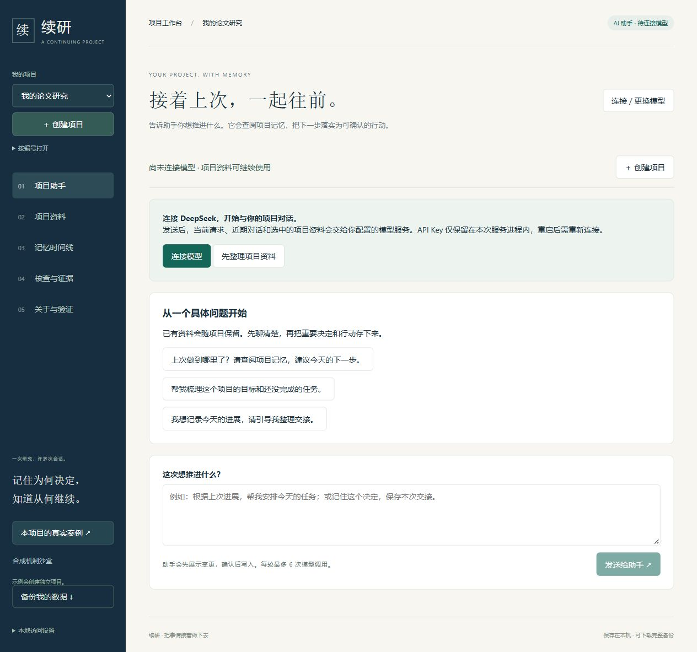
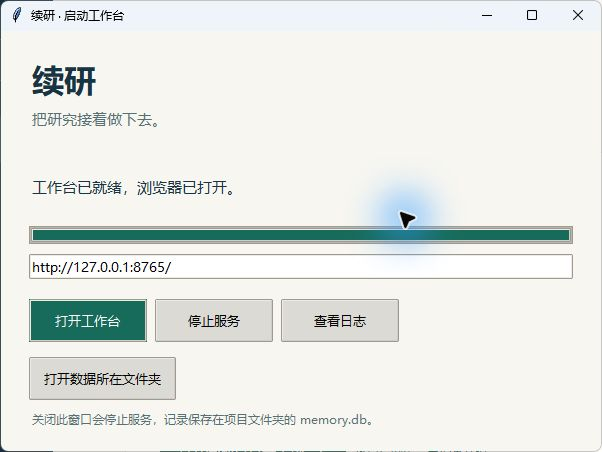
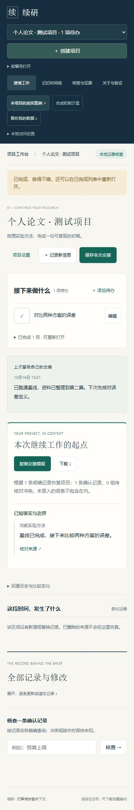

<div align="center">

# 续研 · DIVE 长期记忆助手

### 记得上次，也能推进下一步。

有长期记忆的个人项目 AI 助手。<br>
从对话出发，查阅记忆、提出行动、确认执行，再把进展留给下次。

<p>
  
  
  
</p>

[开始使用](#开始使用) · [产品能力](#产品能力) · [技术与验证](#技术与验证) · [文档导航](#文档导航)

</div>



<p align="center"><sub>真实助手首页 · 独立演示项目 · 模型尚未连接</sub></p>

## 让项目有一个可以回来的地方

写论文、做实验、开发一个小工具，往往要经过许多次工作与对话。续研让助手带着“上次做到哪里、为什么这样决定、接下来做什么”继续协作。记忆与项目数据保存在本机，模型负责理解请求和调用明确的项目工具。

| 你想知道 | 续研帮你找到 |
| --- | --- |
| 上次做到哪了？ | 助手读取项目安排、检索长期记忆，并提供可回看的来源。 |
| 接下来怎么推进？ | 对话中梳理下一步，生成可审阅的待办、记忆或交接变更。 |
| 下次还要重新解释吗？ | 对话和确认的记忆持续保存；也可导出交接简报，带到其他 AI 会话。 |

例如，告诉助手：“记住我们采用 MAE 比较误差，安排两种方案的对比，并保存本次交接。”助手提出具体变更；你确认后，它写入并逐项核验。下次询问采用了什么指标，它再从项目记忆中检索依据。

## 开始使用

### Windows：从一个双击开始

1. [下载项目 ZIP](https://github.com/adfkj2/D.I.V.E.Program_Sanofi/archive/refs/heads/main.zip)，解压到准备长期保留的文件夹。
2. 安装 **Python 3.11+**（推荐 3.12，保留默认 Tcl/Tk 组件），双击文件夹里的 **[启动续研.cmd](启动续研.cmd)**。
3. 浏览器打开 **项目助手**，创建项目，填写名称与目标；已有资料可选择 **导入本地文件夹**，核对自动整理的初始进度和待办后保存。
4. 点击 **连接模型**，保留 DeepSeek 默认地址 `https://api.deepseek.com` 与模型 `deepseek-chat`，填写 API Key 后开始对话。

启动窗口提供停止、重启、查看日志和打开数据目录。首次准备依赖需要联网。AI 对话需要模型 API，按供应商规则计费；未连接时可离线维护项目资料。网页填写的密钥仅留在服务进程中，重启后需重新连接。这个入口随源码提供，仍需 Python 环境。

**[查看完整使用指南 →](开始使用.md)**

<details>
<summary>查看 Windows 启动窗口</summary>



</details>

<details>
<summary>macOS / Linux / Windows 手工安装</summary>

先安装 Python 3.11+ 和 Git，然后获取项目：

```sh
git clone https://github.com/adfkj2/D.I.V.E.Program_Sanofi.git
cd D.I.V.E.Program_Sanofi
python -m venv .venv
```

macOS / Linux 可用 `python3` 替代 `python`，并激活环境：

```sh
source .venv/bin/activate
```

Windows PowerShell 无需激活环境，直接使用虚拟环境里的解释器：

```powershell
.venv\Scripts\python.exe -m pip install -r requirements/runtime.lock
.venv\Scripts\python.exe -m pip install --no-deps .
.venv\Scripts\dive-memory.exe --db memory.db serve --port 8765
```

macOS / Linux 在激活后运行：

```sh
python -m pip install -r requirements/runtime.lock
python -m pip install --no-deps .
dive-memory --db memory.db serve --port 8765
```

打开 <http://127.0.0.1:8765/>。自定义数据库、CLI/API 与可选在线模式见[运行手册](docs/29-runbook.md)。

</details>

## 产品能力

### 01 · 先理解项目，再回应你

对话是主要入口。助手读取项目目标、待办和上次交接，按需检索长期记忆、核对来源，再回答问题或提出行动。项目之间隔离，历史回复与已确认事实分别管理。

创建时可导入已有文件夹：本地优先阅读 README、进度文档和文本任务清单，整理带文件与行号的初始进度。你可以修改摘要、勾选待办，再一起保存资料来源、第一份交接和下一步。此步骤无需模型连接；当前保存文本快照，不会自动同步文件夹，也不据此宣称代码或实验已验证。范围与使用方法见[文件夹导入说明](docs/35-project-folder-import.md)。

### 02 · 把建议变成可核验的操作

助手能新增、编辑或完成待办，保存或更新记忆，留下本次交接与下一步。写入前展示完整提案；确认后整批执行并逐项读回核验。重复确认不会重复写入，资料变化时要求重新生成提案。

> **Agent 闭环：** 你的请求 → 读取记忆 → 工具调用 → 审阅提案 → 执行与核验 → 保存进展 → 下次继续。

### 03 · 长期记忆和数据都能保留

正式记录保存在本机 SQLite 数据库。对话、提案、记忆版本、来源、待办和交接都随完整备份保存；恢复前须停止服务，按[恢复步骤](开始使用.md)操作。新一轮对话读取近期历史和相关记忆，重要事实由你确认后进入长期记忆。

模型连接失败会显示原因并保留本次输入，不把失败包装成成功。每轮最多6次模型调用；手动记录、检索、版本回看和导出交接继续可用。

**[查看模型连接与 Agent 使用指南 →](docs/34-project-agent.md)**

<details>
<summary>查看项目资料的窄屏布局（R46）</summary>

<p align="center">
  
</p>

窄屏展示用于说明布局适配；默认服务只在本机访问，不提供云同步。

</details>

**当前工具范围：** 本地个人项目内的记忆、待办和交接。助手尚不执行代码、联网搜索或修改仓库文件，也不提供云同步与多人权限。发送对话会将当前请求、近期对话和选中的项目资料交给所选模型服务；已完成四个合成项目场景的真实 DeepSeek 验收；真实用户效率与更广泛的回答可靠性仍待验证。

## 技术与验证

评分手册对照：[2026-10-17 评估与改进优先级](docs/oracle/51-handbook-score-review-20261017.md)。当时的代码质量条件估计约17/20；最新工程证据见下文，19/20仍需mentor与本人现场理解验证；Benchmark与总分未经官方认定，答辩及过程表现单独评定。

助手按四层组织：**模型接口 → Agent 工具循环 → 项目工具适配 → 记忆与存储**。助手编排不依赖 Oracle；Oracle 也不依赖助手。后续可独立迭代 benchmark 的写入、检索和 reader 策略，再把经过验证的通用能力接入产品。

[架构与扩展说明](docs/34-project-agent.md) · [核心交付架构](docs/25-delivery-architecture.md)

### 可复核的工程交付

**目标：Benchmark至少95%，代码质量至少19/20；目前尚未达到结项条件。** R62全量记录为435正确、57错误、8未知：已确认正确占87.0%，即使未知全对也仅88.6%。候选未替换默认策略；40题筛选的95%不代表全量成绩。结果为已暴露开发集上的非官方自评。[完整结果与失败](docs/oracle/57-scoped-evidence-and-calculation-20261020.md) · [精选复核证据](artifacts/scoped-evidence-20261020/README.md)。

**R63已修复候选阅读器的工具恢复。** 缺参数和重复请求可在原四次调用上限内修正，存储故障单独报告，失败计算清除旧结果；严格引用与最终轮限制保留。40个内容错误已完成来源链审计。本轮0模型请求/¥0，未重测准确率。[修复报告](docs/oracle/58-bounded-tool-recovery-20261022.md) · [本轮工程证据](artifacts/bounded-tool-recovery-20261022/README.md)。

**R64工程维护与清理。** 源码绑定补齐前端、浏览器、依赖锁和部署配置；修复导入清单与保存时序边界。旧测试数据先校验归档，根目录87个遗留缓存/构建目录已清理，公开验收材料精简为最终结果。[工程记录](docs/oracle/59-engineering-hygiene-20261023.md) · [工作区维护](docs/36-workspace-maintenance.md)。0新增模型请求，未改变Benchmark成绩。

**R65证据阅读重构。** 针对“来源已可见仍答错”、误拒及搜索丢失旧证据，新增可选的证据累积、原句摘录、答案合成与最终复核策略，模型与来源接口保持解耦。32条中英文手写挑战已真实生成并通过AI语义复核；尚未真实测得Oracle提分，默认策略和历史判分保持。[原因分析与架构](docs/oracle/60-deliberative-evidence-20261023.md) · [工程证据](artifacts/deliberative-evidence-20261023/README.md)。

**2026-10-26更新：** R66来源编号策略完成本地工程、独立安装及两次提交的五项远程检查；32条开发挑战通过两位AI审阅者逐项语义复核，但未使用搜索或读取，不能代替Oracle成绩。固定100题候选在第40题连续两次返回空内容后按条件停止：39条有效、1条无效、60条未尝试、0条判分，准确率未知；500题未启动。挑战与候选共216次请求全部有用量，本轮费用¥2.148506，累计保守¥55.888030，历史未知费用预留保持。停止条件已触发，不自动续测或重跑；最新全新500题仍435正确/57错误/8未知，尚未达到95%。[失败诊断与限制](docs/oracle/61-reference-selection-protocol-20261025.md) · [精选证据](artifacts/reference-protocol-20261025/README.md)。

**2026-10-28 R67真实验证完成，未晋级：** 独立可选的分阶段策略完成40条开发挑战，双重AI语义复核40/40，含5条拒答和8条工具场景；这不是Benchmark分数。随后固定100题全部新生成并沿用原judge，得到**91正确、8错误、1未知、0无效输出**，完整accuracy保留null，确认正确下界91%。未达到预设97题及保守对照上界92，500题未启动；与旧同题对照4改善、4退步且确认正确数持平，不能宣称提分。522次请求用量完整，本轮峰值估算¥4.722946，累计保守¥60.610976，历史未知费用预留保留。追加付费执行权限已按条件结束；R68来源保真、证据身份与语义复核已通过本地最终免费门禁，尚无新真实成绩。[结果、费用与限制](docs/oracle/62-staged-completion-budget-20261026.md) · [精选证据](artifacts/staged-completion-20261026/README.md)。

| 验证范围 | 当前证据 |
| --- | --- |
| 本地完整工程门禁 | **1795通过 / 10环境跳过**；完整src静态检查、声明范围的格式及42文件类型检查、294文件源码与数据绑定、三组覆盖门槛通过 |
| 交付层 | **94.77% 行 / 90.58% 分支** |
| 记忆核心 | **92.01% 行 / 80.56% 分支** |
| 共享阅读层 | **94.89% 行 / 88.73% 分支**；包含工作区、分阶段协议与旧策略，门槛不变 |
| 真实语义模型 | 固定BGE-M3完成40/40配对写入/检索，1题来源形成与可见性增加、0来源指标退步；未生成或判分答案 |
| 远程服务检查 | R67源码提交`4c40eb1`及记录提交`8d281a8`各自5项任务全部成功，PostgreSQL实际8/8且零跳过、浏览器20+7项通过；[源码记录](artifacts/staged-completion-20261026/remote-checks-source.json) · [记录提交核验](artifacts/staged-completion-20261026/remote-checks-record.json)。后续提交仍须按自身SHA核验 |

全源码行77.17%、分支71.61%，与局部覆盖分别披露。10项本地跳过包括8项PostgreSQL服务测试、1项普通环境缺模型依赖、1项本机无符号链接权限；上表远程证据对应R67源码与记录提交，模型另有历史GPU材料。R67安装包已在全新环境通过重启、CLI/API、项目核查与交接验证，新阅读工厂另通过脚本模型替身验证。当前结果与历史证据见[五项质量复核入口](docs/32-code-quality-evidence.md)，不会按测试数折算评委分数。

**产品闭环已完成所测范围内的受控个人试用验证。** 真实DeepSeek开发验收经历基线6/10、首修5/6和最终新场景6/6；不同场景不合并成准确率。页面刷新与服务重启恢复、上下文外任务查找、旧交接查阅、歧义澄清和下一步沿用均有记录。提交前额外边界修复由工程回归验证，未伪称重发模型。[验收与适用范围](docs/oracle/49-product-acceptance-20261016.md)。

**评测交付可独立核验。** 公开历史提交核验包和R62全量诊断记录；R62原始输出因16个空答案未通过提交校验，未封装成可提交包。失败与未知均保留，不计为正确。7臂机制实验保留840项与全部失败；完整系统和事件扫描均120/120，不能据此宣称自然语言优势。[交付与机制结果](docs/oracle/55-scoring-readiness-20261018.md) · [评委复核入口](docs/28-submission-and-review.md) · [GitHub Actions](https://github.com/adfkj2/D.I.V.E.Program_Sanofi/actions)。

<details>
<summary>研究背景与评测边界 · LongMemEval Oracle</summary>

DIVE 同时研究长期记忆的写入、更新、时间边界与有据作答。评测链路按独立记忆空间读入历史，经候选抽取、版本更新、检索融合与上下文打包后作答，并保存逐题取舍及失败证据。参考答案仅用于评估。

| 检查 | 结果与解释 |
| --- | --- |
| Oracle R62 全量开发自评 | **435/500（已确认87.0%，另8题未知）**，499题输出+1中断失败计错；零历史答案复用，同家族judge，全开发集已暴露。 |
| Oracle R67 固定100题开发筛选 | **91正确 / 8错误 / 1未知**，全部新生成，原judge，0无效；未过97题门槛，未启动500题，不替代全量成绩。 |
| Oracle R40 历史开发自评 | **451/500（90.2%）**，非官方开发自评；同家族 judge、全开发集已暴露，包含缓存复用。 |
| 独立 reader 工厂对照 | 500/500 输出一致、1110 次缓存命中；是精确回放，不是新成绩。 |
| 结构化状态任务 | 120/120；强事件扫描基线也为 120/120，不能据此证明优势。 |
| 1 万条记录查询中位耗时 | 同机同输入批量化前后为 4.78 s → 0.52 s；不代表模型或并发性能。 |

**以上开发自评均不是官方成绩或合规认证。** 手册 F.1.1/F.1.4 规则审查尚未关闭，正式判分、独立自然语言保留集与真实参与者观察仍待完成。有引用不等于回答正确。

[验证报告](docs/26-verification.md) · [规则审查](docs/oracle/39-compliance-audit-20261012.md) · [逐轮实验总账](docs/oracle/ITERATION_LOG.md)

</details>

R68免费重构已完成本地最终验证：来源角色/陈述时钟统一、稳定证据身份、有界用户发言保留及显式语义复核；独审修复关闭记忆和忘却后的重建复活问题。2041项通过/25环境跳过，独立wheel安装及140文件绑定通过，尚待新提交远程检查。新8条语义开发挑战完成审阅；新候选尚未获付费授权，不能据此宣称准确率提升。[详细证据与边界](docs/oracle/63-source-grounded-decisions-20261028.md) · [精选证据](artifacts/source-grounding-20261028/README.md)。

## 文档导航

| 你想做什么 | 从这里开始 |
| --- | --- |
| 连接模型、使用与扩展 Agent | [项目 Agent 指南](docs/34-project-agent.md) |
| 日常使用、备份与恢复 | [开始使用](开始使用.md) · [运行手册](docs/29-runbook.md) |
| 了解架构与设计取舍 | [交付架构](docs/25-delivery-architecture.md) · [架构决策](docs/adr/) |
| 部署、运维与回滚 | [部署与运维](docs/31-deployment-and-operations.md) |
| 评审代码与质量证据 | [五项质量证据](docs/32-code-quality-evidence.md) · [代码走读](docs/33-code-walkthrough.md) |
| 复核迭代、评测与失败 | [证据索引](artifacts/README.md) · [迭代总账](docs/oracle/ITERATION_LOG.md) · [项目进度](PROJECT_IDEA_AND_PROGRESS.md) |
| 查看提交材料与历史说明 | [提交材料](docs/28-submission-and-review.md) · [历史 README](docs/history/README-before-standard-layout-20261014.md) |

<details>
<summary>开发入口与仓库结构</summary>

```text
src/dive_memory/
├── agent/             # 独立模型协议与有限工具循环
├── application/       # 共用运行时、项目工具与持久对话
├── static/            # 工作台 HTML / CSS / JavaScript
├── reading/           # 通用阅读、证据协议与模型传输
├── oracle/            # LongMemEval 运行器、评测与兼容导出
└── *.py               # 事件、记忆版本、来源、检索与存储

tests/                 # 自动化测试与集成契约
docs/                  # 用户指南、设计、ADR 与迭代报告
artifacts/             # 精选验证证据与源码哈希
ops/                   # Docker/Compose、PostgreSQL 运维与历史实验
audit_tools/           # 审计工具
eval/                  # 评测入口
tools/                 # 质量门禁、装包校验与 Windows 启动器
requirements/          # runtime / dev 精确依赖约束
```

在已激活的虚拟环境中安装开发依赖。本地与 CI 共用质量检查入口；新的运行结果应写入独立输出目录。

```sh
python -m pip install -r requirements/dev.lock
python -m pip install --no-deps -e .
python tools/check_quality.py --output artifacts/my-quality-run
python eval/run_project_validation.py --output artifacts/my-structured-run
python -m build --wheel
python tools/verify_wheel.py --wheel-dir dist --output artifacts/my-wheel-check
```

质量检查包含静态检查、完整回归、行/分支覆盖率门槛与源码绑定。交付层、记忆核心与共享阅读层分别要求 **行覆盖率 ≥90%、分支覆盖率 ≥80%**。CI 配置另包含 PostgreSQL 契约、Docker 就绪探针与浏览器流程。

</details>

---

<p align="center">续研 · 记得上次，也能推进下一步。</p>

第三方依赖与许可声明见 [THIRD_PARTY_NOTICES.md](THIRD_PARTY_NOTICES.md)。

R67源码提交`4c40eb19ca06b83639205236c6e787403eb58044`及记录提交`8d281a879b23e7f5ec2b2d5fe74158447e508821`分别通过自身五项远程任务：PostgreSQL8项零跳过、浏览器20+7项、两版Python及Docker通过。[源码证据](artifacts/staged-completion-20261026/remote-checks-source.json) · [记录提交证据](artifacts/staged-completion-20261026/remote-checks-record.json)。后续提交按自身SHA核验；工程通过不证明95%准确率。
