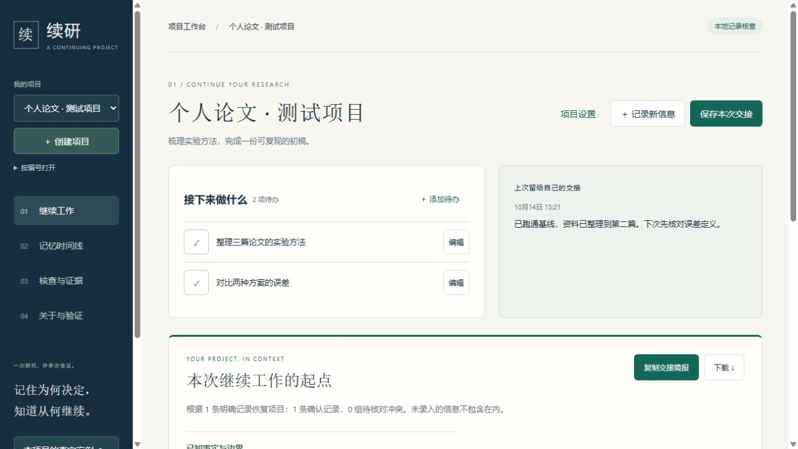

<div align="center">

# 续研 · DIVE 项目记忆

### 把下一步，留给下一次。

为持续推进的个人项目，保存进展、决定与行动。<br>
下次打开，从上次交接继续；换一个 AI 会话，也能带走项目背景。

<p>
  
  
  
</p>

[开始使用](#开始使用) · [产品能力](#产品能力) · [技术与验证](#技术与验证) · [文档导航](#文档导航)

</div>



<p align="center"><sub>真实工作台截图 · 独立演示数据 · 本地单用户研究原型</sub></p>

## 让项目有一个可以回来的地方

写论文、做实验、开发一个小工具，往往要经过许多次工作与对话。续研把“上次做到哪里、为什么这样决定、接下来做什么”放在同一个项目里。

| 你想知道 | 续研帮你找到 |
| --- | --- |
| 上次做到哪了？ | 上次交接、当前记录与待办，打开项目即可查看。 |
| 这个决定为什么改了？ | 记录的来源、历史版本与时间线，保留变化的依据。 |
| 换个 AI 会话怎么接着聊？ | 复制或下载 Markdown 交接简报，把已保存的背景带过去。 |

例如，今天完成论文的实验基线，留下一句“下次先核对误差定义”，并把比较两种方案加入待办。明天打开项目，就有明确的继续起点。

## 开始使用

### Windows：从一个双击开始

1. [下载项目 ZIP](https://github.com/adfkj2/D.I.V.E.Program_Sanofi/archive/refs/heads/main.zip)，解压到准备长期保留的文件夹。
2. 安装 **Python 3.11+**（推荐 3.12，保留默认 Tcl/Tk 组件），双击文件夹里的 **[启动续研.cmd](启动续研.cmd)**。
3. 等待浏览器打开工作台，点击 **创建我的第一个项目**，填写名称与目标。

启动窗口提供停止、重启、查看日志和打开数据目录。首次准备依赖需要联网，之后默认可离线使用，无需账号或模型密钥。这个入口随源码提供，仍需 Python 环境。

**[查看完整使用指南 →](开始使用.md)**

<details>
<summary>查看 Windows 启动窗口</summary>


</details>

<details>
<summary>macOS / Linux / Windows 手工安装</summary>

先安装 Python 3.11+ 和 Git，然后获取项目：

```sh
git clone https://github.com/adfkj2/D.I.V.E.Program_Sanofi.git
cd D.I.V.E.Program_Sanofi
python -m venv .venv
```

macOS / Linux 可用 `python3` 替代 `python`，并激活环境：

```sh
source .venv/bin/activate
```

Windows PowerShell 无需激活环境，直接使用虚拟环境里的解释器：

```powershell
.venv\Scripts\python.exe -m pip install -r requirements/runtime.lock
.venv\Scripts\python.exe -m pip install --no-deps .
.venv\Scripts\dive-memory.exe --db memory.db serve --port 8765
```

macOS / Linux 在激活后运行：

```sh
python -m pip install -r requirements/runtime.lock
python -m pip install --no-deps .
dive-memory --db memory.db serve --port 8765
```

打开 <http://127.0.0.1:8765/>。自定义数据库、CLI/API 与可选在线模式见[运行手册](docs/29-runbook.md)。

</details>

## 产品能力

### 01 · 把进展留在项目里

为每个项目保存名称与目标，集中管理重要事实、决定和依据。按关键词查找当前记录；情况改变时更新原记录，旧版本与来源仍可回看。

### 02 · 给下次工作留一个起点

待办支持新增、编辑、完成与重新打开。离开前保存本次交接，选填的“下一次先做什么”会自动成为待办。同一浏览器下次打开时恢复上次项目，也可以复制或下载交接简报，继续与 AI 协作。

> **一条日常路径：** 创建项目 → 记录进展 → 完成待办 → 保存交接 → 下次继续。

### 03 · 数据在本机，备份可带走

默认使用本机 SQLite 数据库。点击 **备份我的数据**，下载包含所有项目、记录历史、来源、待办和交接的完整备份。恢复前须停止服务，按[恢复步骤](开始使用.md)操作。

新增记录、修改记录和交接的未提交草稿保存在当前浏览器；正式数据在保存成功后写入数据库。备份不含浏览器草稿，项目和新增待办表单请保存后再离开。

<details>
<summary>查看窄屏布局</summary>

<p align="center">
  
</p>

窄屏展示用于说明布局适配；默认服务只在本机访问，不提供云同步。

</details>

**当前适用范围：** 一人、本机、持续维护的个人项目。暂不提供云同步、多人权限、自动文件导入或独立 EXE；记录与交接由使用者维护，真实用户效率收益仍待验证。

## 技术与验证

工作台基于共用应用层提供网页、CLI 与 API。底层以事件、记忆版本和来源关联保留变化，再通过检索与证据打包支持核查。任务安排与事实记录分别管理；默认本地核查有明确的结构化边界，不等同于自由自然语言理解。

### 可复核的工程交付

以下为 **R46 本地验证记录**，本次 README 调整不代表重新运行完整评测。

| 验证项 | 已记录结果 |
| --- | --- |
| 自动化回归 | **1,215 通过 / 9 跳过** |
| 应用交付层覆盖率 | **93.91% 行 / 89.63% 分支** |
| 记忆核心覆盖率 | **91.99% 行 / 80.56% 分支** |
| 浏览器流程 | **23 项开发者操作观察**，覆盖窄屏、断线重试、重启与备份恢复 |
| 安装验证 | wheel 在全新 Python 3.14 运行环境安装与验证通过 |

[查看本轮交付报告](docs/oracle/44-personal-project-loop-20261014.md) · [查看证据清单](artifacts/product-loop-20261014/manifest.json) · [查看 GitHub Actions](https://github.com/adfkj2/D.I.V.E.Program_Sanofi/actions)

覆盖率对应上表指定范围；全包行/分支覆盖率为 **73.91% / 67.59%**。9 项跳过包括 8 项 PostgreSQL 环境检查与 1 项真实语义模型检查，另有 2 条第三方弃用警告。局部门禁通过不代表全源码风格清理完成，历史 Ruff 仍约 113 项诊断。浏览器观察由开发者执行，尚不能证明真实用户效率提升；远程 CI 状态请以 Actions 为准。

<details>
<summary>研究背景与评测边界 · LongMemEval Oracle</summary>

DIVE 同时研究长期记忆的写入、更新、时间边界与有据作答。评测链路按独立记忆空间读入历史，经候选抽取、版本更新、检索融合与上下文打包后作答，并保存逐题取舍及失败证据。参考答案仅用于评估。

| 检查 | 结果与解释 |
| --- | --- |
| Oracle R40 开发自评 | **451/500（90.2%）**，非官方开发自评；同家族 judge、全开发集已暴露，包含缓存复用。 |
| 独立 reader 工厂对照 | 500/500 输出一致、1110 次缓存命中；是精确回放，不是新成绩。 |
| 结构化状态任务 | 120/120；强事件扫描基线也为 120/120，不能据此证明优势。 |
| 1 万条记录查询中位耗时 | 同机同输入批量化前后为 4.78 s → 0.52 s；不代表模型或并发性能。 |

**90.2% 不是官方成绩或合规认证。** 手册 F.1.1/F.1.4 规则审查尚未关闭，正式判分、独立自然语言保留集与真实参与者观察仍待完成。有引用不等于回答正确。

[验证报告](docs/26-verification.md) · [规则审查](docs/oracle/39-compliance-audit-20261012.md) · [逐轮实验总账](docs/oracle/ITERATION_LOG.md)

</details>

## 文档导航

| 你想做什么 | 从这里开始 |
| --- | --- |
| 日常使用、备份与恢复 | [开始使用](开始使用.md) · [运行手册](docs/29-runbook.md) |
| 了解架构与设计取舍 | [交付架构](docs/25-delivery-architecture.md) · [架构决策](docs/adr/) |
| 部署、运维与回滚 | [部署与运维](docs/31-deployment-and-operations.md) |
| 评审代码与质量证据 | [五项质量证据](docs/32-code-quality-evidence.md) · [代码走读](docs/33-code-walkthrough.md) |
| 复核迭代、评测与失败 | [证据索引](artifacts/README.md) · [迭代总账](docs/oracle/ITERATION_LOG.md) · [项目进度](PROJECT_IDEA_AND_PROGRESS.md) |
| 查看提交材料与历史说明 | [提交材料](docs/28-submission-and-review.md) · [历史 README](docs/history/README-before-standard-layout-20261014.md) |

<details>
<summary>开发入口与仓库结构</summary>

```text
src/dive_memory/
├── application/       # 共用运行时与个人项目业务
├── static/            # 工作台 HTML / CSS / JavaScript
├── oracle/            # LongMemEval 运行器、阅读器与校验
└── *.py               # 事件、记忆版本、来源、检索与存储

tests/                 # 自动化测试与集成契约
docs/                  # 用户指南、设计、ADR 与迭代报告
artifacts/             # 精选验证证据与源码哈希
ops/                   # Docker/Compose、PostgreSQL 运维与历史实验
audit_tools/           # 审计工具
eval/                  # 评测入口
tools/                 # 质量门禁、装包校验与 Windows 启动器
requirements/          # runtime / dev 精确依赖约束
```

在已激活的虚拟环境中安装开发依赖。本地与 CI 共用质量检查入口；新的运行结果应写入独立输出目录。

```sh
python -m pip install -r requirements/dev.lock
python -m pip install --no-deps -e .
python tools/check_quality.py --output artifacts/my-quality-run
python eval/run_project_validation.py --output artifacts/my-structured-run
python -m build --wheel
python tools/verify_wheel.py --wheel-dir dist --output artifacts/my-wheel-check
```

质量检查包含静态检查、完整回归、行/分支覆盖率门槛与源码绑定。交付层与记忆核心分别要求 **行覆盖率 ≥90%、分支覆盖率 ≥80%**。CI 配置另包含 PostgreSQL 契约、Docker 就绪探针与浏览器流程。

</details>

---

<p align="center">续研 · 记住为何决定，知道从何继续。</p>

第三方依赖与许可声明见 [THIRD_PARTY_NOTICES.md](THIRD_PARTY_NOTICES.md)。
