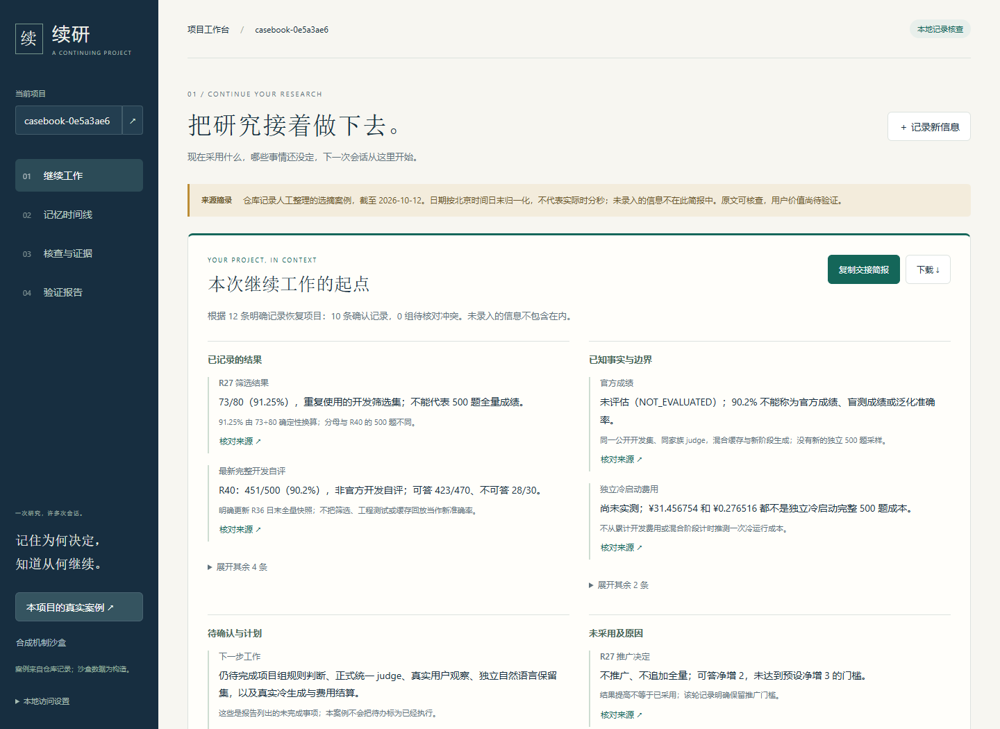

# 续研 · DIVE 项目记忆

为持续数周实验、反复与 AI 协作的学生和初级研发工程师，恢复**当前有效的结论、采纳决定、未采用原因与来源**，再带着一份可核查的简报进入下一次会话。

本仓库就出现过一个容易误读的情况：R27 的 **73/80（91.25%）** 是开发筛选结果，而且没有达到推广门槛；后来的 R40 **451/500（90.2%）** 才是完整开发自评，仍非官方成绩。单看最高百分比会丢失分母、决定与适用边界。续研把这些记录放回各自的时间和来源中，让执行者先确认“可以沿用什么、还有什么没完成”。

本项目是可运行的本地研究原型。用户需求是待验证假设；没有宣称已服务药企或提高真实研发效率。赛诺菲/DIVE 的背景体现在可靠性、可追溯性与工程判断上。



## 五分钟运行

推荐 Python 3.12。在本仓库根目录创建并激活虚拟环境，然后：

```text
python -m pip install -r requirements/runtime.lock
python -m pip install --no-deps .
dive-memory --db memory.db serve --port 8765
```

打开 <http://127.0.0.1:8765/>，选择“载入真实项目案例”。15 条人工整理的仓库记录经普通写入入口形成当前与历史版本，附原文摘录、位置与冻结哈希。这是一份选摘快照，不覆盖完整历史。**这不是自动读取整个仓库，也不是预存问题与答案。**

先读恢复简报，在“记录核查”中查看 `R27 推广决定`、`官方成绩` 或 `下一步工作`，点开原文；再回到历史日期或指定上次工作时间比较变化。最后复制或下载 Markdown 交接简报，带到下一次会话。默认无密钥、无模型调用，受控任务和记录名称直接对应实际状态；不支持的问题明确保留边界。

原有“合成机制沙盒”保留，用于任意改值、冲突与遗忘。检索与在线模型模式单独提供；未配置模型时仍只展示检索证据。结构化核查不冒充任意自然语言理解。

[90 秒故事与六项现场任务](docs/30-project-resumption-demo.md) · [本轮改进与验证](docs/oracle/41-project-resumption-20261013.md)

[完整安装、在线模式、CLI/API 与恢复说明](docs/29-runbook.md) · [实际架构](docs/25-delivery-architecture.md)

## 本轮 R43 验证

完整回归 **1143 通过、9 跳过**；其中新增 19 项覆盖冲突、历史、状态、来源、遗忘与 CLI/API。真实浏览器 17 项流程通过，含连续更新、原文核查、变化比较、复制/下载一致性、手机操作，以及手工改写不冒用原报告来源。0.4.0 安装包在全新 Python 3.12 环境验证，案例随包分发，无需原始报告目录。

[可核查证据与文件哈希](artifacts/project-resumption-20261013/manifest.json) · [实际导出的交接简报](artifacts/project-resumption-20261013/exported-handoff.md) · [手机布局](docs/assets/workbench-resumption-mobile.png)

本轮没有新增模型调用，不改变 90.2% 开发自评。9 项跳过为 8 项 PostgreSQL 与 1 项真实语义模型检查；远程 CI、规则认定和用户观察仍未完成。

## 已保留的 R42 工程与基准证据

| 检查 | 结果 | 边界 |
|---|---|---|
| Oracle 开发自评 R40 | **451/500，90.2%** | 同家族 judge、全 500 题已暴露、含缓存复用；官方未评估 |
| 独立 reader 工厂对照 | 500/500 输出一致，1110 次缓存命中 | 精确回放，0 新请求；不是新答题成绩 |
| 全部本地回归 | 1124 通过、9 跳过 | PG 服务与真实语义模型检查有环境缺口 |
| 结构化状态任务 | 120/120 | 完整事件扫描基线也为 120/120，不证明产品优势 |
| 1 万条记录查询中位时间 | 4.78 秒 → 0.52 秒 | 同机器与输入、来源批量化前后测量；非 LLM 或并发性能 |
| 浏览器 | 桌面/手机真实操作通过 | 不是用户研究；安装与 UI 证据见交付 manifest |

[完整验证与全部失败](docs/26-verification.md) · [R42 执行报告](docs/oracle/40-engineering-delivery-20261012.md)

2026-10-13 干净副本复验：1123 通过、10 跳过（额外缺少完整 Oracle 原文件），500 题回放与构造对照通过。[最终交付记录](artifacts/engineering-20261012/manifest.json)。代码已作本地真实提交，尚未推送远程；远程 CI 未执行。

**规则审查尚未关闭。** 未发现题号或参考答案硬编码的直接证据，但多轮完整评测反馈和规则选择仍有 F.1.1/F.1.4 风险，须向项目组披露并确认。90.2% 不能标为官方成绩或合规认证。[规则审查](docs/oracle/39-compliance-audit-20261012.md) · [提交披露材料](docs/28-submission-and-review.md)

## 复现，而不依赖历史工作目录

```text
python -m pip install -r requirements/dev.lock
python -m pip install --no-deps -e .
python -m pytest -q
python eval/run_project_validation.py --output artifacts/my-structured-run
python audit_tools/replay_bundle.py --verify artifacts/r40-reader-replay.zip --report artifacts/my-replay.json
python -m build --wheel
python tools/verify_wheel.py --wheel-dir dist --output artifacts/my-wheel-check
```

约 4 MB 的 [R40 reader 回放包](artifacts/r40-reader-replay.zip)包含精确请求响应、逐文件哈希和冻结源码；校验程序不具备网络传输能力。原始提交 SHA-256 为 `3b4b5950b9ff93e189250d4dfea57d8683aba094de63dbb33986d7e2a3cb6eb0`。原始历史文件继续保留，另有 [历史哈希索引](artifacts/history-index.json.gz)。

`dive-memory-oracle --dataset 数据路径 --output 新目录` 默认只打印冷运行计划。真正运行需要显式执行参数、请求/token 上限、已缓存语义模型、密钥及预算核对；本轮没有发起新付费生成。冷入口不读取旧答案或判分文件。

## 为什么可能值得用，也为什么可能不值得

价值假设是减少重新交代背景、误用旧约束和重复失败方案。当前强基线与系统的结构化正确率相同，因此必须进一步比较**正确恢复时间和维护负担**，不能靠功能列表证明需求。

本轮把“浏览记忆卡片”推进为“核对项目 → 检查原文 → 比较变化 → 导出交接”的完整任务。新增的是可使用的结果及其查证过程，尚无真实参与者数据证明节省时间。

[3–5 人任务观察材料](docs/27-user-study-kit.md)已准备，尚无真实参与者结果。如果一份事件摘要以相近成本完成任务，项目就收缩为记忆模块与摘要助手。

## 开发与资料

- 生产应用：`src/dive_memory/application/`；工作台：`web.py` 与 `static/`；核心：事件、记忆版本、来源、检索与 SQLite。
- `ops/` / `audit_tools/` / `eval/` 分别保留历史实验、审计和评测，不进入工作台的生成依赖。
- CI 配置包含 Python 3.12/3.14、wheel 安装、可选 PG 服务；远程执行尚待推送触发，不能用配置存在冒充通过。
- [工程实施计划](docs/24-engineering-delivery-plan.md)、[迭代总账 R1–R43](docs/oracle/ITERATION_LOG.md)、[历史 README](docs/history/README-before-engineering-20261012.md)、[第三方说明](THIRD_PARTY_NOTICES.md)。

本机原型采用单进程 SQLite。默认启发式抽取与非语义 hash embedding 不等于 Oracle 的语义模型配置；结构化字段核查不等于自由问答。正式 judge、规则认定、自然语言保留集和用户观察仍待完成。
