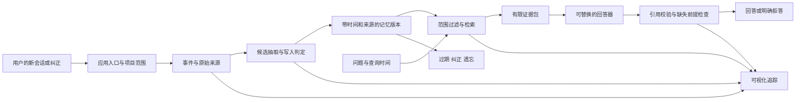

# 从开发成绩到可验证交付：业务定位与工程计划

日期：2026-10-12。此文件保留实施前计划；R42 的实际交付、调整和未完成外部验证见[执行报告](oracle/40-engineering-delivery-20261012.md)。

相关依据：[规则审查](oracle/39-compliance-audit-20261012.md)、[R40 结果](oracle/38-current-state-review-20261012.md)。90.2% 是公开开发集非官方自评，规则审查尚有待关闭风险，不能作为本计划已经成功的前提。

## 1. 先确定谁会用，为什么现在需要

建议定位为：**面向长周期实验项目的个人工作记忆助手，帮助使用 AI 协作的学生和初级研发工程师，在跨会话继续工作时恢复最新约束、有效决策及其依据。**

第一批目标用户应足够窄：独立负责一个持续 2-8 周的公开 AI/软件实验项目、每周多次使用 AI 协助、经常切换聊天或暂停后恢复的学生与初级工程师。DIVE 参与者是可以验证的首批用户候选。用户是执行实验的人；mentor 是成果审阅者，不假定其是采购者。当前不推定存在企业付费市场。

这比直接包装成药企研发平台更有依据：现有仓库真实记录了 R1-R40、预算变更、未推广方案、阶段成绩及中断恢复。它证明项目状态和决策历史客观存在，**尚未证明用户因此付出了多少额外时间，也未证明他们愿意迁移到一个新工具**。

赛诺菲的项目背景可以解释为何重视可靠性、追溯和工程判断力；不足以证明已经发现药企用户需求。未经访谈与任务验证，不使用“已解决药企痛点”“提升研发效率 XX%”等表述。

### 要完成的具体工作

用户隔几天打开新的协作会话，想继续做同一个项目。他需要可靠地回答：

1. 现在采用哪一个基线？最近实验分数更高，是否真的被采用？
2. 当前预算和边界是什么？之前的约束是否已被新的明确决定替换？
3. 为什么没有继续某个看似可行的方向？对应哪个失败证据？
4. 这是已完成结果、未来计划，还是尚未证实的建议？
5. 如果我纠正或删除一条信息，下一次回答是否会真正改变？

输出应是“当前工作简报＋每条事实的来源＋冲突/缺口”，用户可以点开证据、纠正事实，随后开始工作。自动执行实验、自动花费预算与替用户接受建议不属于首版范围。

### 价值来自哪里

原始文件负责保存事实，记忆层负责跨会话找到与当前任务相关、时间有效、可追溯的状态。预算余额必须从可信账本用确定性运算取得；不能由 LLM 根据聊天自行推算出新的财务事实。实验成绩来自报告，采纳状态来自明确决定，两者分别存储。

核心价值假设是：减少每次重述背景和人工核对旧决定的时间，并减少沿用过期约束、把计划当结果、重复已失败方案的错误。只有验证了这些行为，才值得把项目从一个记忆研究原型进一步发展成产品。

## 2. 必须击败的简单替代方案

| 替代方案 | 已经擅长什么 | 本系统必须额外证明什么 |
|---|---|---|
| README＋迭代总账＋人工搜索 | 成本低、透明、用户已在使用 | 在相同材料下更快恢复状态，且不增加错误 |
| 每次保存一页结构化项目摘要 | 简单、容易复制到新会话 | 更新冲突、历史回看、逐条来源与纠正更可靠 |
| 对项目文件做普通 RAG | 按主题查找相关片段 | 能区分“分数最高”与“当前采用”，处理时间更新及缺失前提 |
| 当前聊天的近期上下文 | 使用门槛低 | 跨会话长期变化后仍能恢复有效状态 |

如果一个结构化摘要文件已能以相近时间、准确率和维护成本完成任务，就不扩大成独立平台：收缩为“可审计记忆模块＋项目摘要助手”，把实验结果如实写进答辩。

## 3. 在大规模开发前验证需求

安排 3-5 位符合目标条件的同学或工程师进行任务观察。先让他们描述最近一次跨会话恢复工作、找历史决定或误用旧信息的具体经历，不先展示功能再问“想不想要”。本轮不联系或招募任何人。

使用同一份公开/公开发布的合成项目材料，设计 6-8 个跨会话恢复任务。参与者交叉使用“文档＋摘要”和原型，交错次序，避免后一轮只是记住了答案。固定模型、材料、上下文预算，记录干预与失败。体验反馈与算法准确率分开报告。

| 指标 | 定义 | 预设的产品决策门槛，非已有成绩 |
|---|---|---|
| 恢复时间 | 从打开任务到形成经核对的正确工作简报 | 相对最强简单基线，中位时间至少减少 25% |
| 过期状态错误 | 把已替换/撤销的信息当当前约束 | 至少不增加；小样本不宣称统计显著 |
| 来源核查 | 简报中的关键事实能否定位到支持它的原始事件/文件 | 每条关键事实有来源；缺失就明确标记未知 |
| 用户维护负担 | 每任务补充、纠正、手工标注的次数与时间 | 不高于基线，不能用大量人工录入换取好看指标 |
| 持续需求 | 是否能举出近两周反复发生的同类困难，且愿意再试 | 至少 3 位目标用户给出具体重复场景，否则收缩定位 |

以上用于是否继续投入的内部决策；3-5 人只能支持初步可用性结论。演示与评测内容不得使用患者、企业敏感或真实个人隐私数据。不能为了包装业务故事收集真实药企内部资料。

## 4. 一个可讲清楚、也能现场推翻的演示故事

演示主角为**明确标注的虚构研发学生**，正在做一个公开检索系统实验。采用公开发布的合成对话，不把用户当前私有聊天直接当演示数据。以下数字均是拟定演示材料，不是实测结果。

| 会话 | 输入事件 | 应该出现的状态 |
|---|---|---|
| 第一次 | 设定预算 20 元、采用基线 A、记录答辩日期及阅读偏好 | 写入约束、采纳决定与偏好；保留来源 |
| 第二次 | B 的分数更高，但因延迟过高明确不采用 | 同时保存实验结果与拒绝理由；当前基线仍为 A |
| 第三次 | 明确把预算上限改为 40 元；提出“考虑采用 C”，尚未确认 | 预算新版本有效、旧值可回看；C 仍是提议 |
| 第四次 | 在新会话问“继续之前的工作，现在依据什么行动？” | 简报引用 A 的采纳依据、B 的失败原因、预算最新版本和账本 |
| 第五次 | 问尚未记录的 C 成绩，再纠正一条结果并删除某项偏好 | 对未知成绩拒答；纠正后状态改变；删除项不再进入新回答 |

现场由评委任意替换姓名、金额、日期、语序或增加一条矛盾记录，系统根据新输入重新运行。至少展示一次失败及定位过程。预置回放必须显著标记“回放”，不能把提前保存的回答伪装成现场模型生成。

可以用于开场的叙述：

> 一个实验项目有 40 次尝试，不代表执行者在第 41 次会话里仍知道哪条决定有效。高分实验可能没有被采用，早先的预算可能已经更新，下一步计划也不等于已经完成的工作。本项目把这些信息变成有来源、有时间和可纠正的记忆，让用户继续工作前能核查“系统为什么这样理解我的项目”。我们用公开基准检验记忆问答，用独立任务检验恢复工作是否更快、更可靠。

其中“更快、更可靠”是待测目标，答辩时必须用实际对照结果替换愿景，或明确报告尚未验证。

## 5. 目标架构与实现原则

保持单体应用。默认用 SQLite 完成学生项目的跨会话持久化；如保留 PostgreSQL 支持，则把它作为经过独立契约测试的可选后端。沿用现有事件、记忆版本、来源和生命周期模型，避免另造一套业务专用记忆引擎。

拟定工程边界如下，名称是计划，不代表现有目录已完成迁移：

| 边界 | 职责与约束 | 如何复用现有代码 |
|---|---|---|
| 应用用例层 `application/` | ingest、answer、correct、forget；为 CLI/API/演示提供相同流程 | 从 `service.py` 与两条回答路径提取共用编排 |
| 记忆领域层 | 当前与历史、采纳与提议、来源、冲突、生命周期 | 保留现有模型及不变量，业务字段用 schema 扩展 |
| `storage/` 适配器 | 事务、幂等、投影、检索索引；协议一致 | 按职责逐步拆 `store.py`；不一次重写所有持久化 |
| 回答流程与供应商适配 | 明确输入/输出类型；有限复核、失败与预算 | 将 R40 中通用策略从 `ops` 提取，提供显式配置与 Reader 工厂 |
| 评测适配器 | Oracle 转为公开输入；生成结束后交给 evaluator | gold/reference、题型、旧判分不进入产品依赖 |
| 证据与追踪 | `trace_id`、来源、版本、检索分数、预算、校验结果 | 从现有 trace 提供稳定读模型，所有页面从真实记录读取 |

结构性约束：生产路径不得导入 `ops/`、`audit_tools/` 或读取 `eval/reports/`；不依赖某一轮文件夹的存在才能回答新问题。模型供应商、读写存储和 tokenizer 通过明确接口注入；避免关键边界继续依赖任意 `Any` 和跨脚本导入。

R40 的复杂阅读链先保留行为，不能一边“整理代码”一边悄悄改变策略。精确重放验证只证明重构前后请求与输出一致；后续简化复核链、替换 tokenizer、调整规则均需另立实验并公开收益与退步。

### 必须写成代码约束的行为

- `ANSWER / ABSTAIN / INVALID / ERROR / TIMEOUT` 分开；网络失败不得装成知识不足或正确拒答。
- 事实、决定、计划和建议分开；高分不自动等于已采用。
- source reference、有效时间与记录时间完整保留；不同项目不能混查。
- 同一幂等键重复请求不会形成重复版本；事务中断可恢复，不重复模型付费请求。
- 纠正形成可追溯版本；遗忘区分过期降权、归档及删除，删除同步处理可检索索引与派生缓存。
- 缓存标识覆盖请求、模型/模式和相关配置；无缓存也能对新问题正常运行。
- 对未解决矛盾、缺失必要事实或引用不合法的情况明确返回原因。
- 当前真实 token 与估计证据预算分别报告；不能将启发式估计当精确值。

## 6. 可视化怎样成为验证工具

首版做一个与真实服务相连的验证工作台，四个视图已经足够。优先沿用 FastAPI 加轻量网页，只有确有交互复杂度时才增加前端框架。

| 视图 | 用户能看见什么 | 可操作验证 | 验收标准 |
|---|---|---|---|
| 继续工作 | 当前约束、采纳决定、未确认事项、下一步建议及引用 | 选择项目、开启新会话、询问当前状态 | 重启后状态可恢复；事实与建议分开 |
| 记忆时间线 | 原事件、写入/拒绝原因、旧值→新值、有效区间 | 切换“现在/某一历史日期”，纠正或遗忘 | 新值影响当前回答，旧时点查询保持可解释 |
| 回答证据 | 本次检索候选、最终选中/省略片段、引用、预算及阶段耗时 | 点击回答中的引用；移除/更改一条证据后重新运行 | 引用跳到实际原句；界面与 trace 数据一致 |
| 验证报告 | 基线对照、分类型表现、全部失败、缓存/生成标记 | 查看失败题、切换运行与导出报告 | 每个数字有分母、版本和数据来源；官方分单独留空待结果 |

不能用随机动画模拟写入过程，不能硬编码 90.2% 作为界面常量，不能把缓存结果渲染成“模型实时思考”。加载失败、数据不足、服务未就绪都应有真实状态。

可视化的核心是一条可以闭环的动作链：**输入事件 → 看写入决策 → 发起问题 → 检查引用 → 改变事实 → 重问观察变化**。它比展示记忆数量增长或装饰性知识图谱更能证明机制。

## 7. 三层验证方案

### A. 工程行为：先保护已有能力

把现有 1,108 个通过测试作为起点，不追求测试条目数继续增长。补齐的是尚未证明的行为：

| 必测范围 | 有意义的检查 |
|---|---|
| 真正安装 | 新目录构建 wheel、只装 wheel 与声明依赖，运行跨会话 CLI/API 冒烟；不借助仓库 `PYTHONPATH` |
| 双入口一致性 | 同输入和配置经过 CLI/API 得到同一证据包和状态；演示使用同一应用路径 |
| 领域不变量 | 时间更新、冲突未决、历史查询、计划不升级事实、角色归属 |
| 事务与恢复 | 重复请求、写入中断、重启恢复；索引和记忆版本一致 |
| 隔离与遗忘 | 两项目同名实体隔离；遗忘后新检索、缓存和重新构建不复活被删内容 |
| 模型与失败 | 更换供应商无需更改记忆逻辑；超时、无效输出、限额和引用失效可观察 |
| 防泄漏 | 保持公开输入不变，仅改 gold/题型/答案标记，记忆和模型请求不变；ID 重命名后规范化来源标识再比较行为 |
| 规模与性能 | 固定机器上公开合成 1K/10K 事件，报告 ingest、检索、回答分阶段 p50/p95 及环境；API 与离线路径一致 |

CI 分成快速单元/API、SQLite 跨会话、构建安装、可选 PG 服务集成几组。需要 PG 的工作流必须启动服务，不能把跳过当绿色验证。补充格式、lint 和关键新边界类型检查；覆盖率用于发现关键未测分支，不把某个百分比冒称手册硬要求。

`/healthz` 作为存活检查；新增依赖 readiness，分别说明数据库和已配置模型适配器状态。默认无密钥演示可回放流程，但必须标记模式；在线回答模式需显式配置，不能悄悄降级后展示真实模型能力。

### B. 机制与通用性：独立于 Oracle 的验证

建立约 30 个独立合成多会话故事、每个 4 个问题，共约 120 题。覆盖更新、跨会话综合、来源角色、时间、偏好、缺失信息；故事按项目分组，不能把同故事换实体后拆到开发集与盲评集两边。

先固定验收规则，由未参与 Oracle 调参的评审者保管保留集；若不能做到，明确称为独立开发验证，不能称盲测。材料来自新的项目故事，不能复制 Oracle 的错题结构、措辞或参考答案来制造“新数据”。英语、中文及同义改写分别报告，以暴露现有英语规则的局限。

对照至少包含：近期会话、结构化滚动摘要、普通分块 RAG、完整记忆系统。额外提供去掉更新/去掉写入选择/去掉专门复核的消融，按预设问题选择必要项目，避免成本失控。固定模型、提示基础、检索与上下文预算；多阶段复核另报调用成本。全历史输入如用于研究上界必须单独标为诊断对照，不能成为正式参赛方案。

测量状态正确率、错误采用旧值、缺失前提拒答、来源支持率、恢复时间、token 与费用。实体替换、日期平移、问法改写、无关噪声增加都是稳健性检查，不等同全新真实用户泛化。

### C. 正式 Oracle 交付

工程重构完成后，先用冻结 R40 的精确请求缓存验证行为。需要冷启动运行时，使用独立目录，保存真实新生成与费用，不覆盖旧结果，也不按正确性选用历史答案。

终版配置和代码冻结，记录提交、配置、依赖、数据与输出哈希。按照项目组最新书面要求准备 500 题 JSONL、报告和官方评判预算；必须说明这 500 题曾用于开发。新跑一次或从干净提交运行都不能消除先前的暴露。

重新统计一次全量运行的 token、调用数、费用和耗时。历史累计开发成本、精确回放成本、全新生成成本分开；官方统一 judge 未运行之前保持 `NOT_EVALUATED`。本计划没有启动任何新增付费调用。

## 8. 工作区、提交与复现的整理方法

1. 以实际 Git 仓库为唯一实现目录；在外层说明旧 `src/tests` 的用途，避免运行错项目。本阶段不删除或覆盖旧目录。
2. 先建立文件清单与冻结证据索引，保全 R40 源码、配置、提交、缓存来源与全部失败；整理不能改写成绩。
3. 源码/必要测试进入代码提交；结果摘要、manifest、复现说明进入证据提交；大体积原始产物使用内容哈希索引和可下载归档。归档方案须先证明 clean clone 能取得所需证据，再减少 Git 中的冗余。
4. 临时 pytest 文件、环境、密钥与机器路径不属于公开交付物。对准备公开的产物做实际检查，不能因为 `.gitignore` 存在就宣称没有泄漏风险。
5. 保留已有真实 commit，不重写历史伪造分阶段开发。建议后续每个工作包有小范围提交和自审说明；个人项目不需要制造团队协作 PR。
6. 统一 Python 主版本与依赖锁，给出 CPU 可运行路线和 GPU 可选环境。模型/数据下载地址、版本、许可、哈希与预计体积写清楚。
7. 用 README 的唯一入口完成 fresh clone 验证；生成提交物前进行一次从零安装和完整演示。公开发布形式、署名与品牌使用按项目组规范确认。

## 9. 按评分项分配工作，而不是堆生产功能

手册第 8 页 E.4 的代码质量 20 分为下列构成；并非“工程质量”单项就占 20 分。

| 评分观察面 | 分值 | 优先交付的证据 |
|---|---:|---|
| 机制真实性 | 6 | 独立多会话验证、状态变化与遗忘闭环、对照/消融及失败解释 |
| 架构合理性 | 5 | 统一运行时、明确依赖方向、模型解耦、领域不变量与设计取舍 |
| 工程质量 | 4 | clean install、CI、关键路径与恢复测试、稳定配置、错误处理 |
| 文档质量 | 3 | 面向评委的入口、可复现步骤、一页架构、结果口径与已知限制 |
| 理解深度 | 2 | 本人走读核心代码、解释失败与成本、现场修改并验证行为 |

答辩另有展示 6、问答 9 分：可视化服务于机制与证据，不能用页面精美代替问答能力。协作成长和 JDI 依赖真实辅导、互助与承诺兑现，不能通过补写代码历史制造。

## 10. 建议工作包与验收顺序

以下是单人集中工作量估计，实际取决于用户反馈、环境和评测资源；不是已承诺的交付日期。共约 11-16 个工作日，需求观察可在基础整理期间进行。

| 顺序 | 工作包 | 预计 | 可审阅产物与退出条件 |
|---|---|---|---|
| P0-A | 规则边界与成果冻结 | 1-2 日 | 暴露说明、策略来源表、R40 证据索引；mentor 待确认项清楚，历史结果保全 |
| P0-B | 用户任务验证与简单基线 | 1-2 日 | 任务脚本、观察记录、基线测量；有继续/收缩定位的明确依据 |
| P1-A | 独立运行时与环境 | 3-4 日 | 不依赖历史评测目录的新问题运行；CLI/API 共用编排；锁定环境；重放差异归零或逐项解释 |
| P1-B | 关键工程质量 | 2-3 日 | clean install、CI、持久化/更新/隔离/删除/恢复验证；文档声明与已测后端一致 |
| P1-C | 可视化闭环 | 2-3 日 | 四视图最小工作台，改变输入可改变真实状态与答案；错误与回放标记可见 |
| P2 | 独立验证与提交材料 | 2 日起 | 对照/消融报告、完整失败清单、答辩脚本；正式统一 judge 等待项目组安排 |

评测集过拟合风险未关闭时，仍可做基础工程整理和通用验证，但不包装“已正式达标”的提交。需求验证不通过时，缩小业务外壳；机制对照无优势时，保留结果并解释边界；不能为保住原分数隐去失败。

不纳入近期主线：微服务、Kubernetes、1M 规模、独立图数据库、真实药企系统接入、自动执行代理、多租户商业 SaaS、花哨三维记忆图。手册不要求这些能力，它们也没有被当前目标用户验证为必要。

## 11. 完成定义

- 任何人可按唯一 README 入口在新环境启动；实际演示与正式提交使用同一套记忆核心。
- 原始输入经过真实的写入、更新、检索和遗忘路径，界面可检查每个关键决定。
- 90.2% 始终带有数据暴露、非官方 judge、缓存组成及配置说明；正式成绩单独记录。
- 业务任务有明确用户、最强简单基线和真实测量；没有优势时也有诚实结论。
- 代码质量五个观察面均有可打开的证据，本人能解释核心设计并现场验证一次修改。

以上是 R41 制订的完成定义。随后用户授权 R42 实施；不能用本计划的目标替代 R42 的实测结果，尤其不能将构造任务视为真实用户价值或独立 NLP 泛化验证。
