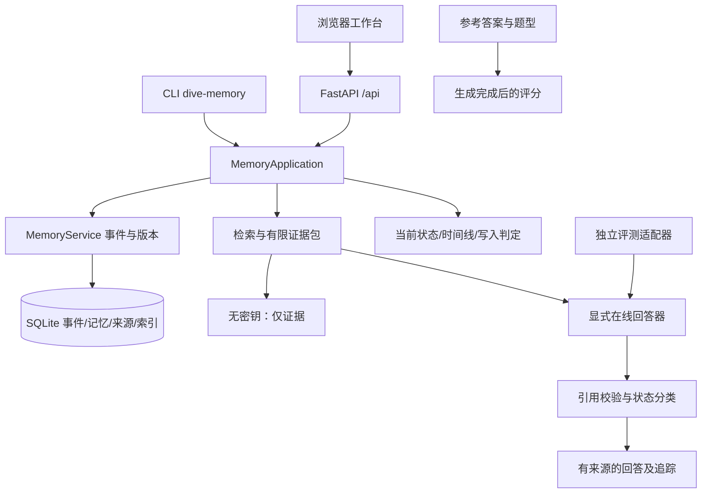

# 续研：应用边界与工程取舍

2026-10-12，R42。产品是本地、单用户、单进程的实验项目记忆工作台。

## 用户与任务

目标用户是独立负责 2–8 周公开实验、反复使用 AI 协作的学生和初级研发工程师。需要恢复的是“目前采用什么、受什么约束、为什么放弃某个方向、哪些只是计划”，而不是无限保存聊天。仓库里的多轮实验说明这种信息确实存在；用户恢复这些信息的困难程度、使用频率和付费意愿仍未验证。

赛诺菲/DIVE 的背景用于说明对可靠性、来源和工程判断的要求。本项目没有声称服务过药企研发团队，也没有患者、临床决策或企业私有知识场景。

## 实际运行结构

`application/runtime.py` 提供写入、明确更新、精确字段核查、检索问答、遗忘和来源读模型。CLI 与 Web 调用同一实例接口。`application/readers.py` 组合现有 reader；不导入 `ops` 或历史报告。`application/oracle_run.py` 是显式 Oracle 评测入口，与交互工作台有各自的输入适配器：两者复用存储、检索、证据及 reader 组件，不声称具有相同的摄入与检索配置。

旧 `api.py` 保留兼容性，不是 README 的工作台入口。评测脚本、历史调参和本轮审计分别留在 `ops/`、`audit_tools/`、`eval/`。包内静态验证报告只在验证页面读取，绝不作为回答模型的输入。

## 事实如何变化

- **明确记录**是用户提供字段并确认状态的输入。它不代表模型自动抽取。`confirmed / proposed / rejected` 明确区分；成绩高不自动成为“已采用”。
- **自然文本**进入既有启发式抽取和写入门；拒绝写入保留决策理由。这个默认路径不是通用语义理解模型。
- **更新**必须指定被替换记录、保持字段与类别/状态、使用更晚的观察时间。同键的新值未明确替换旧值时，保留冲突，精确核查拒答。
- **历史**使用有效区间与观察时间双重过滤。观察时间不能设在未来；未来行动放在提议记录中。
- **幂等**校验内容、明确替换目标及调用者指定的时间；同一个键携带不同载荷会被拒绝。核心事件和投影事务分开，投影中断后用 `dive-memory --db memory.db recover` 恢复。
- **遗忘**硬删除源事件、相关投影与版本，并保留防重建墓碑；不会复活旧内容。应用内该项目的临时回答追踪也失效。用户已经下载到别处的导出文件不在服务控制范围内。

完整事件日志是持久化依据；回答 trace 最多保留最近 100 条，仅在进程内存，重启失效。多项目是数据范围隔离，不是多人账户与权限系统。

## 回答模式

默认 `evidence_only`：不发网络请求、不生成答案，状态为 `EVIDENCE_ONLY`。精确字段核查是确定性结构化查询，界面与返回值明确标注。

在线模式必须设置 `DIVE_MODE=live` 以及 endpoint、model、key。缺配置报错，不静默退回演示回答。`indexed` 为默认在线策略；`r40` 是显式的历史开发策略，通过共享工厂组合多阶段复核。引用必须指向本次可见片段的实际原文。网络超时、执行错误、格式/引用无效和事实不足分别报告 `TIMEOUT / ERROR / INVALID / ABSTAIN`。

readiness 只检测数据库以及是否配置 reader，不假装验证了远程模型连通性。token 预算是启发式估计；模型实际 usage 单独记录。工作台单次问题可能触发多次复核，自动批量评测使用独立请求上限账本。

## 工程取舍

保留单体和 SQLite，不增加队列、集群或微服务。应用锁保护读取—更新用例；核心事务保护事件和索引一致性。不能用多 worker 启动此工作台。可选 PostgreSQL 是已有服务后端与独立契约测试，首版工作台只承诺 SQLite。

R42 性能分析发现逐条来源查询；改为按项目批量读来源，并跳过非语义模式的无用向量解码。保持评分、候选与来源不变，测试核对完整来源及 SQL 查询数。当前仍是本地研究原型，大数据检索仍需遍历候选，不承诺生产级吞吐。

本地接口限制 Host/Origin，支持可选访问令牌、无缓存响应与同源资源策略。令牌仅保存在页面内存；没有外部字体、分析脚本或遥测。公开部署和多人服务需要另行设计身份与资源配额。
