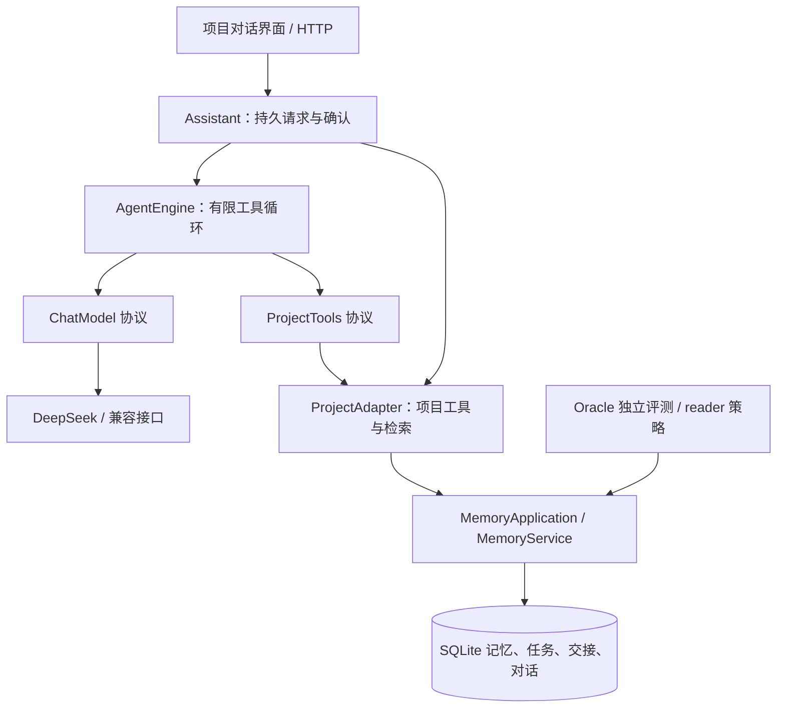

# 长期记忆项目助手：使用与扩展

2026-10-16 · 更新至 R51。主入口是项目对话，支持 DeepSeek / OpenAI 兼容的工具调用接口。

## 从连接模型到下次继续

1. 双击 `启动续研.cmd`，在“项目助手”页创建或选择项目。
2. 点击“连接模型”，DeepSeek 地址为 `https://api.deepseek.com`，模型为 `deepseek-chat`，填写自己的 API Key。
3. 发送具体请求，例如：“记住我们用 MAE 比较误差，添加对比两种方案的待办，并保存本次交接。”
4. 助手读取目标、待办和交接，按需搜索记忆、读取来源。查看提案里的每项变更后，点击“确认并执行这些变更”，或者取消。
5. 执行后显示逐项核验回执。刷新或重启后，对话、已确认记忆、待办和交接仍在；再问“上次采用什么误差指标”，助手可重新检索已保存的记忆。

连接设置保存成功只表示配置有效，发送时才访问供应商。网页填写的密钥仅留在服务进程内，重启后需重新输入；它不会写入数据库、浏览器存储或日志。对话会发送给所选模型供应商，相关上下文包含最近最多6轮成功对话、项目安排及选中的记忆与来源。所有项目共用当前模型配置。

无人值守的本机启动可在自己的运行环境配置 `DIVE_AGENT_ENDPOINT`、`DIVE_AGENT_MODEL`、`DIVE_AGENT_API_KEY`。不要提交密钥文件；`DIVE_AGENT_API_KEY` 是必需项，另两项默认采用上述 DeepSeek 配置。这些变量与 Oracle / 旧问答入口的 `DIVE_READER_*` 分开，双击启动也会读取它们。兼容服务必须支持 Chat Completions 工具调用及 `tool_choice=required`；HTTPS 地址可指向供应商，本机开发接口可用 HTTP。

未连接模型时仍能浏览和手动维护项目资料，但不会生成模拟 AI 回复。

## 这轮 Agent 的动作范围

- **读取**：初始上下文包含项目目标、最多50条待办、最近3条交接；`search_project` 可在本项目全部任务/交接中按字面关键词查找，每次最多20项任务和10条交接，并提示截断。另可按查询检索最多8条记忆、读取检出记忆的来源。
- **提案**：新增待办、编辑/完成/重新打开待办、新增或更新长期记忆、保存交接及下一步。每份提案1–8项，用户确认后执行。
- **核验**：整批操作在同一 SQLite 事务里执行，每项从持久化状态读回校验。任一失败整批回滚；重复确认返回已有结果，避免重复写入。
- **继续**：对话与提案保存在数据库，备份同时包含它们。页面展示最近30轮，模型只接收最近最多6轮成功对话；旧对话不作为已确认事实，长期信息应确认保存为记忆。

每轮最多6次模型请求，每次网络超时45秒，输出上限3000 tokens；请求正文与响应有大小限制，不自动重试付费调用。断网、认证失败、格式错误和循环上限有明确失败状态。浏览器连接断开后，同一条未改变内容的重试复用请求编号；服务重启会把未完成请求标为中断，不执行未确认提案。

处理期间项目变化会使本轮结果失效；确认时也会检查项目快照，避免旧提案覆盖新状态。提示过期时取消后重新发送。API Key、跨项目编号、任意代码执行和删除操作都不属于模型工具参数。

当前是有明确工具范围的项目 Agent：不执行代码、不联网搜索、不修改仓库文件，也不会代替用户完成实验。模型可能理解错误；引用校验检查来源是否实际读取，不判断结论是否正确。默认检索仍使用现有词面/哈希配置，不能把 Oracle 的历史成绩当作助手自然语言准确率。

保存交接时，助手可用 `next_task_id` 明确沿用当前项目的未完成待办，服务端使用原任务标题；手工填写下一步则沿用同名未完成待办，没有才新建。已完成或其他项目的任务不复用。同批次不能同时修改已关联任务；失败时整批回滚。模糊“那一项完成了”应先澄清，仍需审阅提案；这不是模型理解永不出错的保证。

## 可替换的四层

- `agent/protocols.py` 定义模型与项目工具端口；`engine.py` 只依赖端口，不导入 HTTP、数据库或 Oracle。
- `agent/transport.py` 只负责有界的供应商协议，禁止重定向携带凭据。更换供应商可注入新的 `ChatModel`，无需改记忆或评测逻辑。
- `application/agent_tools.py` 适配已有记忆服务与项目事务；查询逻辑可替换，不需要改变 Agent 循环。模型返回的结构化参数在此验证，项目范围由服务端固定。
- `application/assistant.py` 负责运行状态、幂等、并发、历史与提案确认；网络调用期间不占数据库锁。
- `static/assistant.js` 与原资料页面脚本分开；前端使用文本节点展示模型输出，避免将输出作为 HTML 执行。

### 后续 benchmark 提分怎么接

Oracle 的 reader 工厂、实验参数、judge、题集、预算账本和缓存均保持独立。本轮不修改这些实现。可以继续迭代 Oracle 的写入、检索、证据打包与阅读策略；经对照验证有效的通用记忆能力再通过 `MemoryService` 或新的 `ProjectTools` 实现接入产品，不把开发集专用策略默认推广到助手。

独立的架构测试禁止 `agent/` 导入 Oracle、应用存储或 Web；也禁止 Oracle 导入助手编排。自动化使用脚本模型和本地 HTTP 协议替身，分别验证行为与供应商协议；它们不替代真实 DeepSeek 联网及回答质量评估。

## 复核入口

[本轮报告](oracle/45-project-agent-20261015.md) · [迭代总账](oracle/ITERATION_LOG.md) · [交付架构](25-delivery-architecture.md)

## 真实供应商验收补充（R48）

2026-10-15，未修改本指南所述实现，使用真实 DeepSeek 完成四个合成项目场景，开发者验收4/4。配置 deepseek-chat，供应商返回 deepseek-flash；仍需更广泛任务与真实用户验证。回答的内部字段暴露和重复检索属于已发现的待改进项。[完整方法、费用与结果](oracle/46-live-agent-20261015.md)。

## 按需检索与简明回答（R49）

当前任务与最近交接直接作为进度来源；只有本轮问题缺少的决定、约束、结果等事实才需要查记忆。默认正文使用项目名称和日常状态词，内部编号/版本仍在工具参数中，引用仍由界面提供来源按钮；明确技术排查请求可按需解释字段。模型上下文仅保留必要任务字段，包含全项目任务计数与tasks_truncated标记；明细最多50条、交接最近3条，不代表完整历史。没有禁用补充查证，不保证所有模型每次都遵守。真实DeepSeek开发复验与局限见[R49报告](oracle/47-agent-clarity-20261015.md)。

## 交接直接提案与事实边界（R50）

工具优先呈现回答/提案，明确已有任务和用户给出的交接不必先查无关指标；更正记忆、核对原文仍使用检索与来源工具。回答区分未记录与未发生、未完成与未开始，只根据查到的原文解释决定来源。真实开发复验中交接和仅问进度各1次调用，原文查证保留；不保证所有模型每次都遵守。[R50结果、失败与补测](oracle/48-agent-routing-20261016.md)。

## 长期资料查找与个人试用门槛（R51）

新增项目资料查找和已有待办关联，修复初始上下文截断、交接重复待办问题。三阶段真实开发场景分别6/10、5/6和最终6/6，完整保留两轮失败；最终检查含歧义澄清、旧资料、待确认状态和记忆更正。本地单用户所测范围可进入受控个人试用，未证明独立用户的长期效果。[R51验收报告](oracle/49-product-acceptance-20261016.md)。
