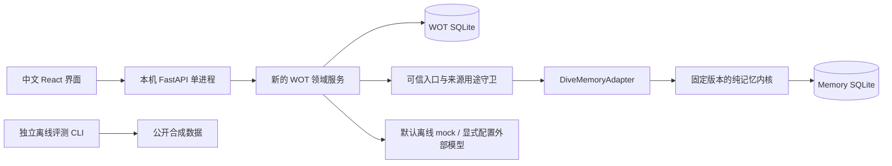

# 新产品边界与工程决策

2026-10-30。依据根目录四份 WeOnceTalked 规范实施，当前交付为本地研究预览。

本日后续升级增加 `connections.py`、`people.py`、`assessments.py`、`virtual.py` 与 `upgrade.py`。模型凭据使用操作系统安全存储或进程内存；个人保留题、答案和预测在独立 `assessment-private.db` 中；严格许可绑定不可变 `user_skill`、协议和模型配置。旧模拟生成接口现仅返回门禁或只读提示，新增生成全部走已校验的 VS 会话。[连接](CONNECTIONS.md)、[评估](ASSESSMENTS.md)、[后台调度](VIRTUAL_SPACE.md)与[升级验收](UPGRADE.md)是当前实现的补充决策。

新调度器独立于浏览器，在最多两个并发请求下按会话公平排队，发布间隔12–25秒，自己的发言保留至少五秒接管时间。开始会话时明确批准本场双方自动分享，取代下面 ADR WOT-004 记载的旧逐轮批准流程。模拟只共享已发布台词；用户画像仅组装给自己的演员。新更正和理想方向形成草稿，不自动替换已校验分身。

应用现为 schema v3，升级前备份完整数据库和头像。导入文本先进入质量评估草稿，旧自定义人物迁为待评；内置人物删除后保存标记。下面保留首版重建决策用于解释长期记忆与来源隔离的历史。

## 产品重建

保留产品名「我们曾聊过」与真聊、三个自我、模拟、成长的用户路径。旧续研工作台、项目导入、项目 Agent、Sanofi/DIVE 项目背景、Oracle 工具及旧网页没有进入新产品。旧版本与数据只作历史归档，不是运行依赖。

## ADR WOT-001：只保留纯记忆闭包

从旧仓库 SHA `eb9898b0a4e4965d8e9d276dc2a76b500461fb68` 提取依赖闭包并固定哈希。没有复制整个旧服务或通过旧 API 运行新产品。保留原始算法与删除语义；上层适配器用原文 observation extractor，避免把旧启发式抽取包装成人格推理。上游原件和哈希见 vendor 清单。

## ADR WOT-002：可信来源与保守画像

客户端不能填写来源、speaker、owner 或认证状态。只有用户消息入口可以批准真实记忆；外部回复、Skill、模拟、反馈使用不同表/记录类型。人格快照仅存证据/已批准目标的 ID 与内容指纹。Perceived 仅显示自我陈述，Observed 当前仅显示单项有出处的假设，不自动判定人格稳定性或给出概率。愿望不进入已发生事实；目标必须再次批准，撤回使相关版本和行动失效。

## ADR WOT-003：跨库 Outbox 与重放

两个 SQLite 库没有伪装成共享事务。应用持久保存 INGEST/DELETE 的 PENDING/APPLIED/FAILED 状态；适配器使用稳定重放键恢复内核投影。删除先在应用拒绝访问、清除正文并使快照失效，再处理核心墓碑。内核暂时失败时，应用继续保持删除状态，不重新暴露内容。重启恢复失败操作。幂等请求先写 fingerprint 占位，资源 ID 由操作标识确定；编译版本由内容寻址，删除后只清敏响应体而保留重放指纹。

## ADR WOT-004：首版模拟公开前由本人检查（旧记录现仅供回看）

两个角色分别调用模型。Persona 只能使用所选快照的授权证据，按主题最多三项；外部角色不接收这些证据或目标对象。模型可能在输出中转述私人资料，因此不能承诺仅靠提示词或字符串检查防泄漏。Persona 的每句输出先呈现给本人，外部人物读取该句前必须明确点击「允许人物阅读上一句并回应」。未批准时后端拒绝发起外部角色请求。

暂停/停止在短数据库事务中生效，不等待生成锁。已发出的 HTTP 请求可能已产生费用，暂停无法撤回已发送资料；在途响应不会被当作成功新回合写入，也不会自动调用下一轮。失败不自动重试；模型变更后必须新开模拟。live 预先保守预留 token，缺用量即停止。当前未校准真实模型的隐私、人格或成长表现。

## ADR WOT-005：删除范围

删除证据会清除应用正文、对应真人消息、同会话 Agent 回复、缓存响应和 mock 上下文；内核硬删除并保留墓碑。相关版本 INVALIDATED，相关模拟内容清除且禁止继续。审计只留操作、ID、时间和哈希。来源 ID 可以保留用于失效追踪，不能作为访问旧正文的通路。旧导出、用户另存的备份及已发送给外部供应商的数据不能被此操作追回。

## ADR WOT-006：本机边界与 Skill

服务只绑定 127.0.0.1；同时检查连接对端 IP、Host、Origin、Fetch-Site、每次启动更新的会话 token。默认没有外网模型和遥测。导入只接收大小受限的纯文本与有限 frontmatter 元数据，不解释 YAML 对象，不读外部引用、文件路径或 URL，不执行脚本。文本在 React 中按普通文本呈现。真实人物授权目前为用户填写许可声明，尚未接入身份验证服务。

## 首版 v2 数据迁移与回滚（当前 v3 另见升级说明）

WOT 应用数据库现为 schema v2，独立于旧 memory.db；没有自动导入旧项目业务记忆。v1 启动升级前用 SQLite backup 在同一数据目录保存 `wot.pre-v2.<时间戳>.db`，随后补稳定消息序号、删除标志、回复状态和新请求的重试参数。旧 ID、会话和证据关系保留。v1 没有记录原始请求参数，因此旧消息不伪造可重试 payload；v2 新消息可按原请求重试。已有删除记录的旧自动标题及回执也在启动时清敏。

自动迁移备份包含升级前私人资料，后续删除不会清除这份旧副本，用户需自行管理。停止进程后，可用 scripts/data.py 对两库做备份；恢复仅允许新目录，避免旧备份覆盖现有删除墓碑。

## 尚未实现或验证

- 自动模型候选抽取、跨会话支持/反例合并与人工审阅；当前是保守的原文证据展示。
- 独立 Judge 进程、外部人工盲评、persona-swap及长期多轮人格忠实度研究；当前严格个人校验仅针对本轮保留情境题，不能推广为普遍人格认证。
- 第三方身份/同意核验、多人联机、公开分享和消息代发。
- 外部供应商价格账本、自动成本估计、跨平台一键安装与真实 API 联调。
- 多端真实用户可用性、长期成长因果收益、外部模型的提示注入抵抗能力。

这些条目没有用单元测试数、固定模板或合成指标冒充已完成。
