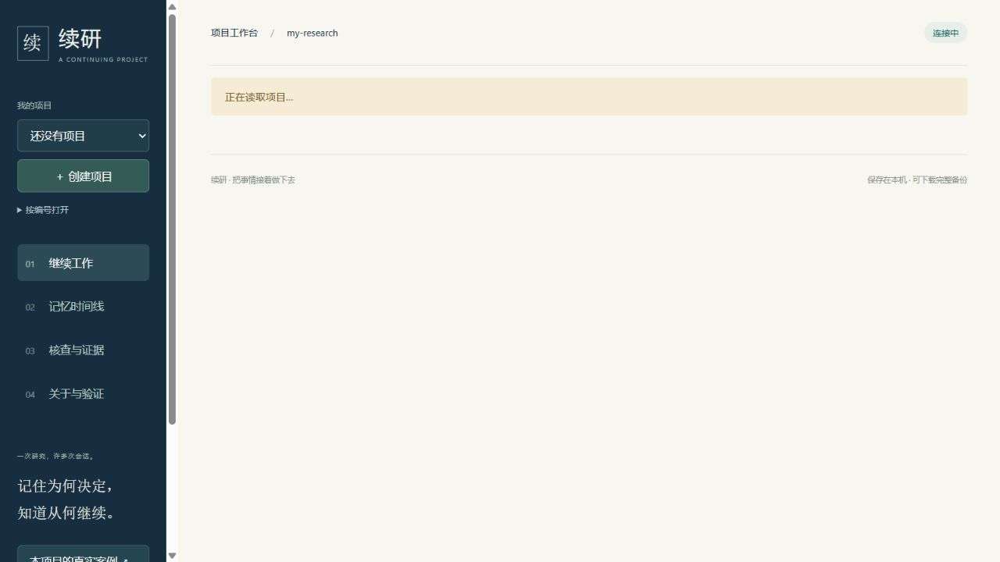

# R46：个人项目日常使用闭环

2026-10-14。用户确认优先场景为“个人项目：记录进展、管理待办、下次继续”。沿用R45工作区，保留之前未提交的质量、启动器和部署改动。正式用户数据库未作为测试数据；Oracle策略、题集、reader、judge、90.2%开发自评及费用账本保持不变。

## 目标与基线

原工作台能展示记忆、核查来源和导出简报，但首次体验偏向案例，项目靠手输编号，没有持久待办和上次交接停点。本轮目标是：创建自己的项目 → 保存及查找记录 → 完成待办 → 留下交接 → 下次继续 → 备份恢复。R45基线1193通过/9跳过；不把工程测试换算成官方评分或用户效率收益。

## 实现与取舍

- 新增项目目录、名称与目标，自动发现原有namespace；原编号入口保留在折叠项中。同一浏览器优先恢复上次项目，URL仍可指定项目。
- `application/workspace.py`以三张SQLite表保存项目、待办、交接。写操作经过应用锁和store事务；待办revision避免旧页面覆盖，完全相同的重试幂等。保存交接及自动新增下一步共用事务，故障后不会留下半条交接。
- 首页优先展示待办与上次交接；新增/完成/重新打开/编辑待办、编辑目标、记录关键词搜索均连接真实API。任务和交接不会自动成为事实或模型证据。历史简报不混入当前工作安排。
- 新增记录、修改记录与交接草稿保留在浏览器，成功后清除；访问令牌只在当前页面内存。弹窗内显示失败提示，断线后保留输入。同一项目切换请求使用版本检查，加载时隐藏旧项目内容。
- SQLite backup接口生成一致快照，包含WAL已提交记录、所有项目、历史、来源、待办、交接和删除墓碑。API受原有本地token边界保护；下载后删除服务临时文件。恢复采用明确的停服文件流程，不做在线覆盖。说明要求旧db和-wal/-shm一起移走保留，避免混用旧日志。
- 保留原有来源、历史、冲突、遗忘、案例与受控核查。主要流程离线、单用户、本机，不新增模型请求。

## 验证与结果

| 验证 | 结果与范围 |
|---|---|
| 针对回归 | 新流程、交付与简报共51项通过 |
| 完整回归 | 1215通过、9跳过；新增22项行为检查 |
| 应用交付层 | 行956/1018（93.91%），分支242/270（89.63%）；新增workspace扩大分母 |
| 记忆核心 | 行1080/1174（91.99%），分支319/396（80.56%） |
| 门禁 | 全源码关键错误、交付范围Ruff/格式、13模块类型和15条案例来源核查；90%/80%阈值保持 |
| 前端 | 格式与语法检查；真实CUA浏览器23项操作观察，详见检查清单 |
| 浏览器故障路径 | 专用服务停止→保存失败显示中文提示且输入保留→同库服务重启→原表单重试成功；不是模拟网络返回 |
| 备份恢复 | 实际浏览器下载文件在独立副本打开：1项目、2待办、1交接、2版记录，SQLite完整性ok；自动测试另覆盖遗忘墓碑与重建不复活 |
| 安装包 | Python3.14全新venv安装最终wheel，从site-packages导入，无PYTHONPATH注入；CLI/API、静态资源、案例、个人交接及备份恢复成功；pip check通过 |

浏览器观察由开发者工具完成，不是23位用户或23项用户研究。桌面默认视口和390×844窄屏已操作；窄屏内容宽375px（含滚动条差异），没有横向溢出。新增CI浏览器流程已写入 `tools/verify_workbench.cjs`，本轮本地通过CUA执行等价操作；没有声称远程CI已运行。

全包行8543/11559（73.91%）、分支2202/3258（67.59%），未把交付层门槛冒称全包达标。完整分母及9项跳过原因留在质量报告中。跳过为8项可选PostgreSQL和1项真实语义模型；第三方库有2条弃用警告。这些未被计为通过。

## 失败、修正与中断

1. 首次导入检查发现新模块误用`Store`类名，改为实际的`SQLiteStore`；随后针对51项检查通过。格式与导入排序也已修正。
2. 浏览器实际操作发现：自动使用上次交接作为比较起点后，回看更早历史会收到`since must not be later`错误。修复为自动清除无效起点，用户手选晚于查看时点的起点则显示中文提示；实际复验历史记录与当前待办隔离成功，并加入CI场景。
3. 对话中断使原临时终端服务和浏览器标签失效，出现连接拒绝；恢复专用测试服务后继续。未访问或修改真实memory.db。后续故意停止服务用于断线测试，属于预期失败。
4. README先引用尚未落盘的本轮报告和manifest，导致一次收尾全量检查1214通过/1失败/9跳过；失败是相对链接检查。报告与证据落盘后复验，不删除断言，保留该运行于 `quality-final/`。
5. 全新环境最初安装全部开发依赖耗时过长，主动中断；改用运行依赖锁文件和httpx，并限定网络重试，安装成功。最终wheel独立验证完成，未把中断当通过。较早构建产物保留，最终包通过资源逐字节一致性核对。

## 交付与边界

[开始使用](../../开始使用.md) · [公开证据](../../artifacts/product-loop-20261014/manifest.json) · [浏览器观察清单](../../artifacts/product-loop-20261014/browser-checks.json) · [安装验证](../../artifacts/product-loop-20261014/wheel-release-summary.json)。原始结果位于 `eval/reports/product-loop-20261014/`；最终门禁 `quality-release/` 已通过（源码检查期间未变）；[最终质量摘要](../../artifacts/product-loop-20261014/quality/summary.json)。不覆盖之前成功或失败结果。

采用本轮功能，闭合本机个人项目日常流程。尚无真实参与者的连续使用观察，不能断言已提高生产效率。仍无多人权限、云同步、自动文件导入和独立EXE；手工恢复需要停服。草稿依赖同一浏览器与站点，完整备份不含未提交草稿；交接界面显示最近20次，完整数据库保留全部历史。新增项目和待办表单尚不保存未提交草稿。已导出备份不会因后续遗忘而自动清除。

0新模型请求、¥0；历史累计¥31.456754，Oracle 451/500（90.2%）非官方开发自评保持。下一步价值验证应观察真实使用者隔日继续项目的成功率、耗时与维护负担，不以功能数替代用户证据。
